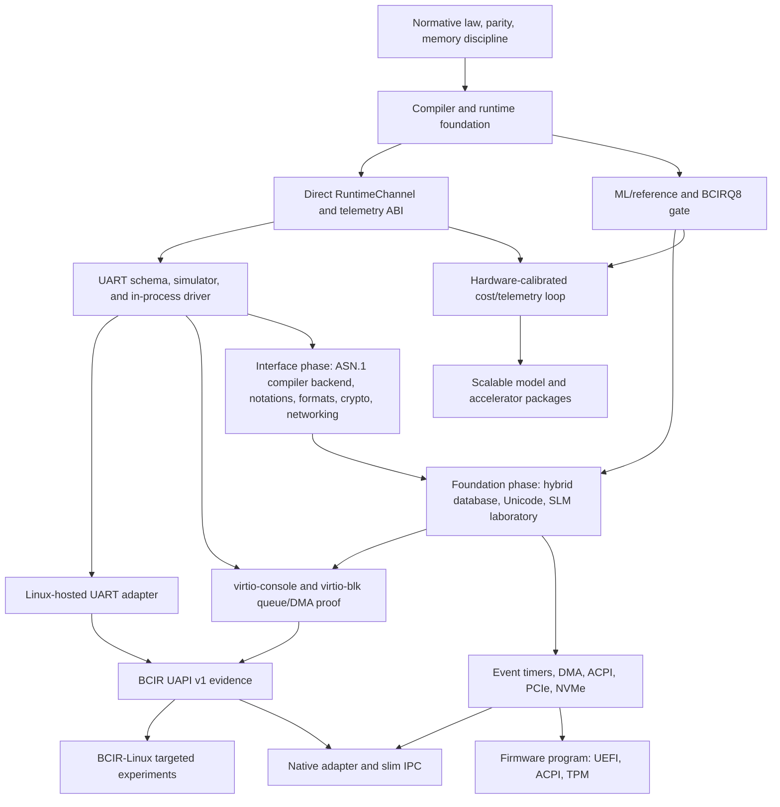

# BCIR Master Roadmap

> **Scope:** current execution plan for package version `0.2.0`.
>
> This document owns cross-program order, promotion gates, and stop conditions. It does
> not carry test counts, PR chronology, or completed-wave notes. Static inventories come
> from generated [`STATUS.md`](STATUS.md); implementation truth is summarized in
> [`REPO_CURRENT_STATE_AUDIT.md`](REPO_CURRENT_STATE_AUDIT.md); the build record lives in
> [`DEVELOPMENT_HISTORY.md`](DEVELOPMENT_HISTORY.md). The `0.3b` release notes remain an
> unreleased draft.

## 1. Mission and non-negotiable invariants

BCIR is a registry-first, phase-ordered, lane-typed, cost-governed correspondence IR.
It preserves a computation's semantic claim, legal physical realizations, selected plan,
GEM schedule, target lowering, and provenance as one auditable chain.

The proposed [universal serialization/interface program](BCIR_UNIVERSAL_INTERFACE_ROADMAP.md)
connects typed service contracts, format providers, native bindings and direct/Linux/native
adapters. Its UDSI milestones and SI tests extend the interface plan; they add no current
codec, transport, POSIX or cross-ISA native-binary support.

The proposed [driver/IPC data and AI qualification program](research/BCIR_DRIVER_IPC_AI_QUALIFICATION_2026-10-20.md)
makes applicable data, inference and training workloads part of driver promotion. Their
measured ownership, movement and completion behavior guides IPC; qualified relevant drivers
and IPC precede physical HAM and native HAM/SYCL integration. Existing HAM planning and hosted
SYCL reference work remain software foundations, not physical deployment evidence.

Every program in this roadmap obeys these invariants:

1. **Legality precedes optimization.** R1–R25 and device-specific laws reject illegal
   candidates before K_BCIR prices them.
2. **One semantic truth, multiple realizations.** Python is the executable oracle; MLIR is
   the compiled law rail; C is the freestanding/hosted realization rail. A new rail earns
   support through differential parity, not assertion.
3. **Learning proposes; certificates dispose.** Learned or measured data may rank and
   calibrate legal choices. It never becomes a legality verdict or steers in-flight work.
4. **Artifacts are immutable within a generation.** Plans, StreamPacks, model weights,
   driver programs, and learned priors are content-addressed, generation-tagged, and stale
   on any relevant input change.
5. **The core is platform-neutral.** Linux, Windows, POSIX, vendor runtimes, IPC, and hosted
   allocation are adapters around the direct contracts; none becomes the definition of BCIR.
6. **Unsupported work fails honestly.** Partial AOT, modeled channels, compiler fixtures,
   portable fallbacks, and hardware-gated code are labeled as such.
7. **Evidence controls promotion.** A feature needs implementation, deterministic positive
   coverage, refusal coverage where malformed input exists, and all required CI checks.

The normative semantics and artifact contract are in
[`BCIR_LANGREF.md`](BCIR_LANGREF.md). The Python↔MLIR↔C correspondence is governed by
[`PARITY.md`](PARITY.md).

## 2. Architecture and current baseline

### 2.1 IR levels

| Level | Responsibility | Current realization |
|---|---|---|
| BCIR-0 | Semantic claims and state transformations | Python model/frontends; MLIR BCIR dialect |
| BCIR-1 | Shaped data, layouts, records, tensors | Resource/layout model; GEM tensor ops; binary-record/model frontends |
| BCIR-2 | Registry and placement candidates | Registry, device manifests, memory banks, channels, generations |
| BCIR-3 | Legal K_BCIR realization plan | Exact integer cost search, RCSP/Pareto, schedule-aware price, certified priors |
| BCIR-4 | GEM execution and StreamPack | Hydration, wave/token scheduling, v1–v4 StreamPack, C executor |
| BCIR-5 | Target lowering and distribution | Partial LLVM/MLIR, portable C23, WASM/JVM/CIL subsets, SYCL/SPIR-V channel, resident toolchains, deterministic BCAB target-image selection |

### 2.2 Implementation rails

| Rail | Owns | Explicit boundary |
|---|---|---|
| `bcir/` | Dependency-free conformance oracle plus import-quarantined hosted-model adapters, K_BCIR, GEM, frontends, ML/reference organs, and BCAB codec/selection tools | Hosted PyTorch execution is optional and must re-enter through strict oracle ingestion; not the production law definition |
| `mlir/` | ODS/IRDL structure, compiled verifier and transformations, target-edge lowering | `bcir-aot` is partial preparation; Python LLVM lowering accepts one supported elementwise claim |
| `runtime/c/` | Freestanding runtime, C-front twin, hosted model/compiler tools, direct RuntimeChannel | Memory classes are explicit; no hidden platform or IPC dependency in freestanding code |
| `runtime/cpp/` | Hosted orchestration above the C ABI | Single-node handoff is real; distributed/device-manager backends remain scaffolded |
| LLVM/Clang/GCC/vendor stacks | General-purpose isel, register allocation, object production, vendor device/runtime internals | Consumed rather than reimplemented unless a decision gate proves a missing BCIR-owned requirement |

### 2.3 Source-backed status

| Area | Landed baseline | Boundary that remains |
|---|---|---|
| Law and optimizer | R1–R25, twelve-axis cost vectors, exact planning (a compact offer table and indexed min-plus pass, with a freestanding C twin that writes the same plan bytes), RCSP/Pareto, overlap pricing, replay/provenance, frozen learned priors | Additional laws require a demonstrated semantic gap and dual-rail negative coverage |
| GEM and StreamPack | Hydration, scheduling, execution, strict v1–v4 codecs, C/Python byte parity, operator disassembly/hexdump; the plan → pack → bytes → verdict chain advanced by declared deltas (the plan, the pack and the verdict re-derived over the delta's cone, each equal to the chain from scratch) | Hardware command packets and per-device execution are not implied; the delta chain is oracle-only and admits replacements only |
| C compiler | Broad driver-oriented C23 subset, twin lowering, Clang differentials, target ABI matrix, project/link/fallback modes | Not complete ISO C23; unsupported constructs route to the resident compiler |
| C memory/runtime | Freestanding/hosted/driver classes, allocator injection, failure tests, direct RuntimeChannel v1; the freestanding data-plane pack table (write once, read in place through epoch-bearing handles, admitted by the live control plane), the per-step freeze and the BSHM manifest-of-shards, with the C++ RAII seam over them and the Stage 3 exit flow identical on three rails | No out-of-process transport or resident hardware binding; no pack table shared across processes; no cross-node shard transport |
| ML/reference | Tensor claims, closed-set AD, planned/streamed training, optional hosted Llama/AdamW micro training, safe resume/export, model ingest/tokenizer/decode, BCIRQ8, standalone-C parity, native Q8/Q4 conversion and Q8 projection kernels, exact native Q15 retrieval, payload-free placement, exact static tensor addresses, verified HAM residency/routes, strict context shards, dual-memory oracle, a bounded GNN/Transformer hardware-policy gate, adaptive and raw-byte BLT/MambaByte experiments, exact sequence-interface adaptation, causal FSQ series coding, and active-budget growth | The 32M, byte-native, and progressive models are untrained at useful scale; hardware-RL evidence is simulated; HAM has no physical adapter; no whole-model Q4, distributed trainer, GPU byte/model backend, live promotion corpus, or production serving engine |
| Telemetry | Stable signal registry, BTLM codec, continuity/ring witnesses, metrics, deterministic Prometheus/OTLP/Redfish-shaped serialization; the version-zero driver envelope, generated C signal table and live concurrent ring with Python/C parity | No live HTTP/OTLP/BMC/UART transport; no driver emits through the version-zero contracts yet |
| Machine edge | Typed MMIO/port/fence/control-register/MSR operations, ordinary x86 long-mode entry and interrupt trampoline, real object/disassembly gates | Reset transition, paranoid NMI/IST entry, feature-specific entry policy, native CPU backend remain open |
| Artifact compatibility | BCAB v1 deterministic multi-image envelope, standard payload preservation, Python/C/C++ selection, MLIR metadata projection, listing/hex/extraction and delegated disassembly | No signature/trust directory, pack symbol relocation, OS loader, or claim of cross-ISA binary compatibility |
| Drivers/kernel | Device-manifest/event/DMA substrates, direct hook ABI, generic HAM compiler/simulator contract, driver package and BCIR-Linux plans | No resident device driver, GDS/P2PDMA/CXL/NVMe adapter, Linux module/fork, stable UAPI, native kernel, or native IPC is present |
| Performance evidence | Bounded cross-organ audit, deterministic result digests, controlled-box budget rail, exact scheduler/static-layout differential tests | Target-specific TMSAO certificate still needs PMU/energy/thermal evidence and exhaustive measured candidates |

The exact driver boundary is maintained in
[`kernel/BCIR_DRIVER_KERNEL_ROADMAP.md`](kernel/BCIR_DRIVER_KERNEL_ROADMAP.md). Machine-code
coverage and GO/STOP rules are maintained in
[`BCIR_MACHINE_CODE_HAL_ISA_AUDIT.md`](BCIR_MACHINE_CODE_HAL_ISA_AUDIT.md) and
[`BCIR_NATIVE_OBJECT_GATE.md`](BCIR_NATIVE_OBJECT_GATE.md).

## 3. Dependency order

After UART, two phases run before deep driver and kernel work, by the owner's direction. First
the **interface phase** (§3.4): the ASN.1 compiler's backend, the peer notations and formats, the
cryptographic standards and networking over hosted transports. Then the **foundation phase**: the hybrid database, the Unicode infrastructure and the small-language-model laboratory
with its initial lessons (the corpus-side roadmaps under `training/`); the device order that
follows is the driver roadmap's §5.6. §3.1 sizes the phase and §3.2 says what sends the work back
to drivers.

The driver and ML programs share compiler, runtime, telemetry, artifact, and validation
machinery. Neither may bypass the other's prerequisites: model acceleration needs real device
packages; learned driver optimization needs stable direct behavior and trace identity.

### 3.1 The foundation phase, sized (review of 2026-11-08, `main` after #825)

It runs after §3.4's interface phase. The sizing below is unchanged by that order.

| Program | Ladder | Landed | Open |
|---|---|---|---|
| Hybrid database: the training catalog and retrieval rail ([`training/DATABASE_ROADMAP.md`](../training/DATABASE_ROADMAP.md)) | S1–S19 and the performance suite's P1–P4 | All of it: content-addressed sets behind generations, postings with exact joint statistics, sorted numeric indexes with zone maps, a ten-operator predicate language, a legality-first planner priced on the K_BCIR cost vector, the native Q15 top-k under a predicate mask, one transaction per publish, a stored derived column. The hybrid SQL/vector path already runs end to end. | It is one-table-shaped (the three generalizations of [`UNICODE_ROADMAP.md`](../training/UNICODE_ROADMAP.md) §5.3). It has no second vector space per row, no exact fusion of two rankings, no sharding above the kernel's 65,536-row ceiling and no replayable lookup certificate. Those are UC-3 and SLM-2 to SLM-5. |
| Unicode 17.0 database ([`training/UNICODE_ROADMAP.md`](../training/UNICODE_ROADMAP.md)) | UC-1–UC-11 | None. | All of it. The tree still normalizes text with the interpreter's own tables, a different Unicode version on each interpreter the suite runs: 14.0 on 3.11, 15.0 on 3.12, 17.0 on 3.15. |
| Small-language-model laboratory ([`training/SLM_ROADMAP.md`](../training/SLM_ROADMAP.md)) | SLM-1–SLM-13 | None of its slices. What it builds on has landed: the native decoder trainer (`runtime/c/bcir_decoder_train.c` over `bcir_tensor.c`) gives complete dense Llama/SwiGLU training in C, bit-identical at every thread count under declared GEMM, exponential, reduction and bf16 contracts. Around it: the NDT ladder of [`research/BCIR_TRAINING_ACCELERATION_ROADMAP.md`](research/BCIR_TRAINING_ACCELERATION_ROADMAP.md); the train rail (TRAIN-RAIL: the `BCIR-Corpus-860K` recipe trained on CI); the hosted stage pipeline; and BCIRQ8 → C inference parity. | Every slice. Nothing in `SLM-*` starts before UC-3, and SLM-1 needs UC-7 and UC-8. |

**The phase's exit (build this much before the drivers resume): fifteen slices, one PR each, in
this order.**

1. **Unicode UC-1 to UC-8, the whole Latin stage.** Stopping at UC-7 would leave SLM-1 blocked:
   UC-8 (the DER character record and UAX #29 segmentation) is the last slice that adds a
   mechanism, and SLM-1 needs it. UC-9 to UC-11 add repertoire, not mechanisms. UC-3 is also the
   database's next slice: it makes the catalog hold a second declared table, additively, with the
   chunk table byte-identical. UC-7 is the traceability payoff: tables pinned to 17.0 replace the
   interpreter's, so one corpus reaches one digest on every supported Python.
2. **The rest of the database: SLM-2 to SLM-5.** SLM-2 is the lookup request: six appended
   legality rules and its price. SLM-3 is exact sharded fusion, on synthetic sets until UC-10
   supplies the real two spaces. SLM-4 is the DER `LookupEnvelope`, replayable on any host.
   SLM-5 is the frozen query projection. After them, every lookup is planned, priced, refusable
   and replayable: the database the model consults.
3. **The laboratory's initial lessons: SLM-1, SLM-6 and SLM-7.** SLM-1 is the record interface and
   `bcir.byte_bpe.v2`. SLM-6 puts the engines in as `verify` callbacks in bounded reasoning search.
   SLM-7 makes curriculum phase 1 (orthographic grounding) a content-addressed stage. SLM-7b stays
   optional.

In numbering order that is UC-1 … UC-8, then SLM-1 … SLM-7: every slice's dependencies land
before it.

**Deferred, then interleaved with the drivers one slice at a time:**
- UC-9, the other scripts.
- UC-10, Han. The vendored data triples and the row count rises about a hundredfold. That meets the
  catalog's declared ceilings and the database's reopening condition for approximate nearest
  neighbours at about 50,000 rows, so it is a measured decision.
- UC-11, the rest of 17.0 and the LangRef made normative.
- SLM-8 to SLM-13: tree-constrained attention, the recursive cell, the lexical graph behind its
  GO/STOP, the curriculum ledger, the evaluation harness and the scale GO/STOP.

None of these blocks a driver, and no driver blocks them.

### 3.2 What sends the work back to drivers and kernels

Not a memory bottleneck as such. Three rules decide it.

1. **The first driver block runs on a schedule, not a trigger.** The event timers, DMA with the
   ownership engine, and the virtio queue proof come first. They are preconditions of everything
   after them: NVMe, the IPC rungs, HAM's physical tiers, UEFI with the trust program, and the JIT
   microkernel. None of them waits for a model to slow down; they resume when §3.1's exit is met.
2. **After that, a measured bottleneck sends the work to the layer that owns it.** A memory
   bottleneck inside one process is user-space work. The native trainer has been closing those in
   user space:
   - the step's state on one huge-page mapping (NDT-PAGES);
   - the transient arena laid out by lifetime (NDT-MEM);
   - the attention's tasks on contiguous copies of their rows (ATT-CONTIG);
   - the weight adjoints split over their depth (KSPLIT).

   A driver or the kernel pays only where the measured time crosses a boundary user space cannot
   move. Attribution is the training ladder's NEXT-n method: time the step a part at a time against
   the host's measured rates, then name the layer.

   | What the trace attributes the time to | The layer that owns it | Where it is planned |
   |---|---|---|
   | Data crossing devices: accelerator memory, peer transfers | DMA, IOMMU, PCIe, the GPU driver | driver order 2, 5, 12; HMF-D1/D2 |
   | Datasets and checkpoints larger than the page cache | NVMe queues, the semantic store | order 6; HMF-D4 |
   | Page size, pinning, NUMA placement and memory tiers beyond `madvise` | memory inventory, HAM | order 10; HMF-D3 |
   | Copies and wakeups between processes | the IPC rungs | driver roadmap §7.4, I1–I5 |
   | Jitter from interrupts and other tenants | timers, interrupt routing, the microkernel | order 1, 13 |
   | Counters a certificate needs | a physical rig: this cloud host has no PMU | CPU and PMU, order 11; TMSAO-3 |
3. **On this host, model scale will not surface a driver-shaped bottleneck soon.** The host has
   4 vCPUs, 16 GB, no GPU and no PMU. The corpus recipe's model and the 9.84M study decoder live in
   cache and RAM. Driver-shaped bottlenecks appear when the dataset outgrows the page cache, when
   training moves to an accelerator, or when tensors cross processes. That is why the driver order
   puts DMA, NVMe and the IPC rungs early, and why each driver is qualified against a data,
   inference and training profile (driver roadmap §4.7;
   [`research/BCIR_DRIVER_IPC_AI_QUALIFICATION_2026-10-20.md`](research/BCIR_DRIVER_IPC_AI_QUALIFICATION_2026-10-20.md)).

How the program goals map onto this order:
- **Fully capable JIT microkernels** are the driver ladder's end (order 13). Driver roadmap §7.5
  defines one as a preverified, content-addressed service bundle, and it needs the whole evidence
  chain below it.
- **TMSAO on data-structure execution**: the database's next slices put retrieval under the
  plan, legality, price and certificate machinery GEM+ already runs. The proof rail issues
  TMSAO-1/TMSAO-2; TMSAO-3 waits on hardware.
- **TMSAO on AI inference**: the NDT and Q8 ladders and BCIRQ8 → C.
- **Full traceability**:
  - UC-7: the Unicode version in every digest;
  - SLM-4: every lookup a replayable DER envelope;
  - SLM-12: no reported number without its digests;
  - StreamPack and BCAB provenance throughout.

### 3.3 One system: database, Unicode and the laboratory as AI processes

The three foundation programs are one system, not three. [`BCIR_AI_SYSTEM_ROADMAP.md`](BCIR_AI_SYSTEM_ROADMAP.md)
(2026-11-08, design) defines it:
- **One knowledge plane.** A knowledge epoch binds every generation a result read: the Unicode
  version, the catalogs, the sets, the tokenizer, the projection, the checkpoint and the plan
  baseline. Every certificate names one epoch.
- **One planner and one artifact path for every workload.** Lookups and text processing take the
  path the training step already takes (PX-2b): K_BCIR plan → GEM+ schedule → StreamPack →
  executor.
- **What K_BCIR and GEM+ need.** No new laws and no new cost axes. They need new claim families,
  the landed SDF, timed and expectation regions (G22–G24) put to work on the pipeline between
  services, and six algorithms beyond the Unicode roadmap and the ML system: joins, batched
  lookup, a fused native text pipeline, a priced cache, channel-mode selection and stream
  generations.
- **The OS model.** Eight service roles (text, store, train, infer, plan, verify, ledger, agent)
  run on the IPC program's four primitives. Control records travel on SPSC rings; generations
  are mapped read-only; batch buffers move by lease. The workloads are learning-database building
  and query, language processing and agent coding.

Its slices, AIS-1 to AIS-9, start after §3.1's exit and alternate with the driver order. AIS-1 to
AIS-6 need no driver; AIS-7 waits for DMA's lease laws.

### 3.4 The interface phase comes first (2026-11-08)

The database, the Unicode work and the laboratory went ahead of the compiler backend. The owner's
direction is to finish the backend first. [`BCIR_INTERFACE_PHASE_ROADMAP.md`](BCIR_INTERFACE_PHASE_ROADMAP.md)
sizes the phase at twenty-five slices, IF-1 to IF-25, in six stages:

| Stage | Slices | What it finishes |
|---|---|---|
| A. The ASN.1 compiler | IF-1–IF-7 | A real-world grammar corpus; the three refused X.680 constructs; schema-driven random values; `cgen` from study scale to production (`DEFAULT`, extensions, `SET`, character strings, open types, DER/BER and aligned PER), selectable under K_BCIR's certificate; a CLI, a bit-layout report and a security-regression corpus |
| B. Qualification | IF-8, IF-9 | Independent comparators and five whole-process workloads on x86-64 and aarch64, and the rule for when "faster" or "smaller" may be claimed. The ITS result stays a scoped `ratio` until then. |
| C. JSON | IF-10 | The minimal compiled JSON investigation, ending in GO or STOP |
| D. Notations and formats | IF-11–IF-18 | The contract registry and native BCIR JSON, ABNF, CSN.1, XDR, CBOR/CDDL, Protocol Buffers, XML 1.0, SDXF and MessagePack |
| E. Cryptographic standards | IF-19–IF-23 | A provider contract with verified and reference providers; X.509 path validation; CMS and PKCS #1/#8/#10; S/MIME 4.0; a sans-I/O TLS 1.3 engine |
| F. Networking | IF-24, IF-25 | Packet, checksum and DNS codecs; hosted UDP/TCP, HTTP/1.1 and TLS |

Its slices that need Unicode run ASCII-first with declared refusals, so the phase does not wait on
UC-n. Native networking needs virtio-net and DMA leases, so it joins the driver order (driver
roadmap §5.6, row 3).

## 4. Active workstreams

### 4.1 Language and compiler rail

Current work is maintenance and bounded completion, not another breadth sprint:

- Keep C-front twin/Clang equivalence, project linking, diagnostics, target ABI, and memory
  discipline green while driver fixtures become real programs.
- Add C standard-library/compiler surfaces only when a driver or model slice requires them.
  Near-term ML-relevant gaps are `<stdbit.h>`, `<stdckdint.h>`, verifier-fed `assume`, and
  packed sub-byte storage/compute semantics.
- **The subset against the runtime's own C** ([`research/BCIR_C_SUBSET_AUDIT_2026-11-10.md`](research/BCIR_C_SUBSET_AUDIT_2026-11-10.md)).
  The verified compiler parses 6 of the 33 runtime library units today, 15 once three
  conformance gaps close (CSUB-1), and compiles 10 with R1–R18 clean. The ladder:
  - CSUB-1, conformance: multi-line macro calls, file-scope `static_assert`, complete
    freestanding headers;
  - CSUB-2, table idioms;
  - CSUB-3, `<stdbit.h>` and `<stdckdint.h>`;
  - CSUB-4, `<stdatomic.h>`'s explicit-order calls;
  - CSUB-5, a hosted profile;
  - CSUB-6, AI numerics at the source level.

  A ratchet gate holds the set of runtime units the verified compiler accepts.
- Preserve the C++ airlock: C owns stable value/resource ABI; C++ owns hosted graph and
  distributed orchestration. Implement a backend only with an executable consumer and teardown
  tests.
- Place any future C++, Python, Java, Fortran, CIL, JVM, or other language roadmap under
  [`languages/`](languages/). Use fallback/standard ABI integration before proposing a full
  frontend.

Promotion gate: twin parity, relevant Clang/GCC differentials, strict warnings, sanitizer and
allocator-failure coverage, target-aware linking, and no expansion of the freestanding dependency
surface.

**Which language a port goes to** ([`research/BCIR_NATIVE_PORT_AUDIT_2026-11-09.md`](research/BCIR_NATIVE_PORT_AUDIT_2026-11-09.md),
2026-11-09):
- **C**: code that runs on a target, in a driver, in a microkernel or on the artifact path. The
  K_BCIR core planner `bcir_kplan.c` stays C.
- **C++23**: the hosted toolchain. The GEM+ solver portfolio, the incremental engine, the ASN.1
  host compiler and the memory fabric's planning form one library behind a C ABI façade, using
  arena (`pmr`) memory and `std::expected` errors. Its plans are always re-checked by the C and
  MLIR verifiers, which share no code with it.
- **Python**: everything else stays the oracle.

The audit lists 54 modules to port, in three tiers, and a PORT-0–PORT-10 order.

### 4.2 Machine-code and backend rail

LLVM remains the resident implementation of general CPU machine-code work. BCIR currently owns
typed target/device edges, StreamPack/operator tools, verification, device-command assembly, and
BCAB v1 packaging/selection around unmodified standard artifacts. BCAB is not MC7 pack linking or
MC11 object linking. The next sequence is:

1. Complete source-module symbol resolution and a freestanding C twin for MC1 disassembly.
2. Bind MC2 registry operations through RuntimeChannel only after a real driver resource exists.
3. Build MC3–MC9 from the concrete UART/virtio command and lifecycle needs.
4. Treat MC10–MC14—native isel, object/link, ABI frame, debug metadata, and binary trust—as a
   separate backend program behind the native-object decision gate.
5. Build MC15 telemetry identity before freezing a driver UAPI.

ELF/DWARF conformance means consuming platform formats and system linkers correctly; it does not
authorize a new general-purpose linker or debugger. See
[`BCIR_MACHINE_CODE_HAL_ISA_AUDIT.md`](BCIR_MACHINE_CODE_HAL_ISA_AUDIT.md).

### 4.3 Driver, Linux, and native-kernel rail

The canonical order is evidence-first:

1. Emit through the version-zero driver telemetry envelope, signal table and live ring from
   the first driver, and revise them from its traces.
2. Implement the 16550/16750 UART schema, assembler/verifier/simulator, polled direct driver,
   event-driven direct driver, and deterministic replay corpus.
3. Add the Linux-hosted UART adapter and prove direct/adapter parity.
4. Establish the separate BCIR-Linux LTS/next rails and stock-Linux baseline.
5. Prove queue/DMA behavior with virtio-console and virtio-blk.
6. Freeze UAPI v1 only after UART and virtio-blk cover MMIO/event and queue/DMA lifecycles.
7. Implement slim native IPC only after direct, Linux, and native traces agree.
8. Qualify each driver's applicable data/inference/training profile and use complete-workload
   traces to optimize IPC. UART remains a transport/lifecycle proof; compute targets earn
   inference and training support separately, with explicit provider/fallback identities.
9. Bind physical HAM and finally native HAM/SYCL only after the relevant driver/IPC workload
   gates pass; continue existing planner/oracle and hosted-provider experiments beforehand.
10. After UART and the foundation phase, build in the driver roadmap's §5.6 order — event timers,
    DMA and the ownership engine, the virtio queue proof, ACPI's static tables, PCIe, NVMe, the
    IPC rungs, UEFI with TPM, USB, memory inventory, CPU, GPUs, then the master kernel — on the one
    driver contract of §5.5. The firmware (§5.7) and IPC (§7.4) programs are planned and not
    started; the open-source and vendor sources are §5.8–§5.9; the fork's plan is §6.4.

Driver packages reuse one authoritative device schema to generate register/packet definitions,
assembler, decoder, verifier, simulator, RuntimeChannel binding, telemetry schema, replay corpus,
and target-specific frozen priors. Linux and native adapters surround identical direct behavior.
The full maturity ladder and kernel escalation policy live in
[`kernel/BCIR_DRIVER_KERNEL_ROADMAP.md`](kernel/BCIR_DRIVER_KERNEL_ROADMAP.md).

### 4.4 ML and model rail

Seven bounded seams are proven: immutable TinyLlama inputs produce a deterministic group-Q8 artifact
with Python/C parity; the optional hosted lab trains a 90,688-element model from random weights
through exact safe resume, strict Safetensors ingestion, BCIRQ8, and standalone C; an offline
provider-neutral gate exercises generated-corpus pretraining, SFT, reward, DPO, PPO, verified
reasoning, embedding distillation, and three small architecture families with deterministic replay;
a tiny hardware policy combines an availability-aware telemetry Transformer, memory-topology GNN,
metric reward/DPO/PPO, bounded PUCT, verified plan lowering, and exact static addresses; an adaptive
lab validates tied depth, fixed-residual variable widths, reference-sliding, exogenous anchors, and
multi-patch models; and a byte-native lab validates raw-byte BLT/BLT-D/BLT-S/BLT-DV, learned
patching, MambaByte, exact-shape global transplantation, and measured ingest selection. Both
architecture labs use tiny hosted training and ordinary verified claims/StreamPack without adding
their experimental shapes to BCIRQ8 or the C decoder.
A sequence-interface lab additionally proves exact-byte cross-tokenizer alignment and credit
projection, continued-BPE decomposition/copy/mean/freeze semantics, bounded unigram segmentation,
multi-objective tokenizer evidence, causal FSQ time-series prefixes, fixed binary token interfaces,
and newest-block-only constructive growth. Its dense growth stages lower through ordinary verified
claims/StreamPack; glyph/PCA, large tokenizer construction, balanced multilingual continuation,
LoRA execution, and useful-scale growth remain gated.
The generic HAM slice adds semantic-resource DAGs, declared-link routing, dynamic residency and
generation replay, context-shard activation, and a fuzzy-ranking/hard-fact-veto memory oracle.
Its gate is simulated and deliberately cannot issue a live promotion certificate.
The Python/native placement audit has also closed the current high-confidence CPU data-plane
ports: group Q8/Q4 conversion, standalone-Q8 matvec/head loops, exact Q15 retrieval, and native
bounded model measurement. The independent Python oracle remains mandatory. See
[`BCIR_PYTHON_NATIVE_BOUNDARY_AUDIT.md`](machine-learning/BCIR_PYTHON_NATIVE_BOUNDARY_AUDIT.md);
future native work must present a measured bottleneck and a stable differential contract.

Generated weights remain build-only. The active queue is:

1. Extend the landed BCIRQ4T/AVX2/SmoothQuant tensor slice to whole-decoder Q4, model-level
   compactness/drift/NLL, ARM/other targets, and independently specified additional formats.
2. Qualify the landed measured schedule artifact on at least two real targets and publish GEMM
   versus fused/attention evidence separately before target promotion.
3. Qualify differentiate-high/optimize-low and rematerialization on representative graphs; keep
   aliased mutation, unbounded control, recursion, and dynamic higher-order calls quarantined.
4. Differentially freeze the pinned 16,384-piece tokenizer, then train and evaluate the specified
   BCIR-TinyStories-32M model on a canonical hosted rig; local work is pilot-only.
5. Establish SDPA device parity, static request-owned KV/CUDA graphs, then verified BCIRQ8 GPU
   execution before defining BCIRQ4 or custom attention kernels.
6. Replay real CPU and driver episodes through the hardware policy; add verified
   rematerialize/checkpoint/KV-reuse actions on top of the landed HAM action rail; compare policy-guided search with exhaustive portfolios on two
   physical targets; freeze deployment weights only after measured, quiescent promotion/rollback.
7. Extend the landed payload-free resident/layer-stream/host-device planner into executable
   batching and hardware-qualified placement, then complete sampling, raw-text standalone
   tokenization, bounded serving, and architecture coverage in that order.
8. Implement live teacher/remote-compute adapters only behind the provider-neutral artifact ABI,
   explicit credentials/policy, cost limits, and offline replay; embeddings remain frozen targets.
9. Extend the landed bounded HAM/dual-memory oracle with durable ingest/index/recovery only behind
   schema, provenance, corruption, recall/filter-parity, and bounded-memory contracts.
10. Profile adaptive per-shape kernels and fused fixed-residual carry on two targets before defining
    checkpoint/export schemas, GQA/native parity, or any production architecture promotion.
11. Evaluate byte-native corpus quality and patch distributions, then add safe checkpoint/export,
    fused local/scan/patch kernels, two-target measurements, and only afterward a native/GPU
    inference format. Architecture-specific byteified Llama/Gemma mappings require exact tensor
    provenance and quality recovery; device-side UTF-8/ingest and DMA overlap remain driver work.
12. Build multilingual/domain tokenizer corpora and reconstruction/probe/generative evaluations;
    qualify balanced continued-BPE expansion and multi-seed dense-versus-growth/LoRA runs before
    any sequence interface or progressive checkpoint is promoted. Glyph/PCA assets require pinned
    fonts/renderers/configuration, while GPU suffix/token kernels remain driver-qualified work.

The detailed closure register, model ladder, and explicit production gaps are in
[`machine-learning/BCIR_ML_AI_INTEGRATION_ROADMAP.md`](machine-learning/BCIR_ML_AI_INTEGRATION_ROADMAP.md).

### 4.5 Telemetry and continual optimization

Telemetry is driver/kernel infrastructure, not a dashboard afterthought. The progression is:

- stable signal IDs, units, kinds, and snapshot semantics;
- strict frame and bounded-ring integrity with source/session/generation/clock/loss identity;
- deterministic derived metrics and claim/plan/PC correlation;
- offline replay, calibration, exhaustive-equivalence certificates, and immutable next-generation
  artifacts;
- activation only at quiescent generation boundaries with rollback.

Live transports are adapters. Prometheus text and OTLP/Redfish-shaped JSON do not imply HTTP,
protobuf, gRPC, BMC, or UART delivery. Normative details live in
[`kernel/SIGNAL_REGISTRY.md`](kernel/SIGNAL_REGISTRY.md),
[`kernel/TELEMETRY_FRAME_ABI.md`](kernel/TELEMETRY_FRAME_ABI.md), and
[`kernel/TELEMETRY_PIPELINE_RESEARCH.md`](kernel/TELEMETRY_PIPELINE_RESEARCH.md).

## 5. Program milestones

| Milestone | Current state | Exit evidence |
|---|---|---|
| Foundation law/parity | Landed | R1–R25 negative coverage, generated differentials, deterministic replay |
| C/runtime memory discipline | Landed baseline | Strict hosted/freestanding builds, allocation-failure campaign, sanitizers, idempotent teardown |
| Pre-driver machine edge | Partial landed | Ordinary x86 edge and MC1/MC2 baselines; paranoid/reset and hardware binding remain explicit |
| UART direct package | Partial landed | U0 on every rail, U1 on the oracle, U2's polled driver against the simulated 16550 linked from both rails' emit; U1's law-rail half and the event-driven slices remain for D0–D2's cancellation, saturation and replay |
| Interface phase | Open, first: before the foundation phase; sized in §3.4 (ASN.1 encoding rules and ECN landed; `cgen` study-scale; no peer format, CMS/PKCS/S/MIME/TLS or networking) | The twenty-five slices IF-1–IF-25 of [`BCIR_INTERFACE_PHASE_ROADMAP.md`](BCIR_INTERFACE_PHASE_ROADMAP.md), each at its own gate |
| Foundation phase | Open, after the interface phase and before deep driver work; sized in §3.1 (database S1–S19 landed; Unicode and the SLM's own slices not started) | The fifteen slices of §3.1, each at its own roadmap's gates: UC-1–UC-8 (UC-3 the database's second table), SLM-2–SLM-5 (the rest of the database), SLM-1, SLM-6, SLM-7 (the initial lessons) |
| UART Linux adapter | Open | D3 direct/adapter behavioral parity and unload/restart safety |
| virtio queue proof | Open | Character/event plus block/DMA lifecycle, reset and saturation evidence |
| BCIR UAPI v1 | Gated | UART + virtio-blk evidence, generated ABI tests, compatibility and failure matrix |
| BCIR-Linux experiment rails | Open | Reproducible LTS/next baselines; invasive patches only for measured stock-interface gaps |
| Native kernel/IPC proof | Gated | Boot/memory/IRQ/PCIe/DMA prerequisites and direct/Linux/native parity |
| Firmware program (UEFI, ACPI, SMBIOS, TPM) | Planned | Stage A on QEMU+OVMF+swtpm: reproducible boot, refused unauthorized image, measured runtime, validated tables (driver roadmap §5.7) |
| IPC program I1–I8 | Planned | Each rung against its Linux or reference comparator with whole-lifecycle measurement (driver roadmap §7.4) |
| Trust program RoT0–RoT8 (root of trust, TPM, measured kernel) | Planned | Measured boot, sealing, runtime integrity and attestation on QEMU + OVMF + swtpm, then RoT simulation and dynamic launch ([`kernel/BCIR_ROOT_OF_TRUST_ROADMAP.md`](kernel/BCIR_ROOT_OF_TRUST_ROADMAP.md)) |
| Data/AI driver and IPC qualification | Proposed extension | Per-device capability/profile; dataset-to-completion/checkpoint evidence, model quality and measured direct/hosted/native behavior under existing D/M/OT/SI/BG gates |
| Small real-model reference | Landed | Pinned source hashes, BCIRQ8 compactness, Python/C ID and logit parity |
| Hosted train-to-C micro gate | Landed | Random-weight CPU training, exact resume, deterministic Safetensors/Q8 export, Python/C parity |
| Adaptive architecture lab | Bounded reference landed | Per-shape fusion/counters on two targets, export schema, GQA/native parity, and quality evaluation |
| Payload-free model planning | Landed baseline | Header inventory, exact memory report, measured intervals, placement candidates, verified claim/StreamPack plan; target execution remains open |
| HAM/model-artifact fabric | Compiler/simulator baseline landed | Semantic DAG, exact declared-link routes, capacity/generation replay, StreamPack lowering, context-shard rollback, and dual-memory hard veto; physical adapters require qualified relevant drivers/IPC; native HAM/SYCL follows physical qualification |
| Hardware RL plan policy | Bounded simulated gate landed | Real telemetry corpus, exhaustive two-target comparison, verified rematerialization/spill actions, frozen deployment artifact, measured quiescent promotion/rollback |
| BCIR-TinyStories-32M | Spec/pins landed | Tokenizer differential, canonical BF16 run, validation/model card, reviewed publication artifacts |
| Concrete-target qualification ([QUAL](BCIR_QUALIFICATION.md)) | Landed on one model, one host + CI x86-64/AArch64 | A second physical target with hardware counters; BCIR-TinyStories-32M through the same harness |
| Low-bit/model scaling | Partial | Versioned format, R17/error evidence, target execution, sampling/batching/placement gates |
| Closed learned optimization loop | Partial | Real driver/model telemetry, exhaustive-equivalence certificate, quiescent activation and rollback |

Milestone status is descriptive, not a test report. Exact repository inventories remain generated
in [`STATUS.md`](STATUS.md).

## 6. Release policy

### 6.1 Current package

`0.2.0` is the current package version. Its supported claims are the checked-in interfaces and
explicit subsets documented by the LangRef, parity ledger, C-front guide, and current-state audit.
No document may claim a later tag or stable driver/kernel ABI.

### 6.2 Draft 0.3b

[`RELEASE_NOTES_0.3b.md`](RELEASE_NOTES_0.3b.md) is an unreleased candidate definition for a
freestanding driver-oriented C compiler/runtime milestone. It may advance only when:

- the documented C subset, fallback contract, project linking, and target ABI matrix agree on both
  rails;
- all runtime C memory, sanitizer, fuzz, differential, and strict-warning gates pass;
- the first direct driver package proves lifecycle and telemetry integration;
- docs and generated inventories contain no release/version/support drift.

### 6.3 Later releases

Later versions are evidence-based, not date-based. A stable UAPI release follows UART and
virtio-blk. A native-kernel release follows boot/runtime and direct/Linux/native parity. A model
serving release follows sampling, tokenizer, batching, device, safety, and evaluation gates.

## 7. Validation and publication gate

Every runtime/compiler/driver/ABI change must map to the complete required CI inventory. Locally,
run bounded focused gates and the complete supported x86 suites with at most two workers; do not use
unbounded fuzzing, nested high-parallelism builds, or local architecture emulation. Managed CI/cloud
owns Windows, native ARM, long fuzzing, analyzers, and future kernel matrices.

Minimum publication evidence:

1. Generated status, Markdown links, retired paths, import quarantine, and `git diff --check`.
2. Quick and thorough Python suites with exact outcomes recorded.
3. Strict C11/C23 warnings plus ASan/UBSan/LSan, allocator-failure and ownership checks.
4. Bounded differential/fuzz campaigns with fixed seeds and deterministic regressions.
5. MLIR ODS/IRDL/pass/assembly/object gates on the supported LLVM version.
6. Wire-format corruption, truncation, overlap, reserved-field, CRC, and round-trip tests.
7. Real-model gate for any change that can affect model ingest, quantization, decoding, or C math.
8. Hosted train/checkpoint/export gate on Ubuntu and Windows for hosted-model changes.
9. Native Windows and ARM jobs for portability-sensitive changes.
10. All required GitHub checks green before handoff; pending is not complete.

Hardware claims additionally require the runbook in
[`kernel/HARDWARE_VALIDATION.md`](kernel/HARDWARE_VALIDATION.md), including baselines,
measurement validity, toolchain/profile identity, and honest degraded/skipped results.

## 8. Decision boundaries

- **AOT:** Python LLVM lowering remains a single-claim elementwise subset (it carries the
  claim's declared alias facts -- `noalias`, alias scopes, TBAA, `volatile`, a barrier's fences,
  G9/S5-A); MLIR `bcir-aot`
  remains partial preparation. Arbitrary-graph native lowering is a separate approved program.
- **Native backend:** use LLVM/resident toolchains until the native-object gate demonstrates a
  repeated BCIR-owned gap with bounded scope and maintenance ownership.
- **Vendor drivers:** inherit or wrap AMDGPU/ROCm, NVIDIA/CUDA, and other vendor stacks unless
  measurement justifies an independently reviewed replacement effort.
- **IPC:** direct in-process RuntimeChannel first. Process separation requires privilege isolation,
  crash containment, vendor isolation, or multi-client sharing and must preserve behavior. Native
  IPC is four primitives (shared region, doorbell, waitable word, submission/completion ring), not a
  reimplementation of Linux's facilities, which stay the compatibility rail and the baselines.
- **Firmware:** firmware initializes and attests the machine; BCIR owns verified runtime execution.
  Build on EDK II or coreboot, keep resident firmware minimal, replace a PI component only with a
  measured advantage.
- **Linux fork:** stock interfaces and out-of-tree adapters establish the baseline. Fork patches
  require a measured residual gap, rollback, rebase, and upstreamability analysis.
- **Learning:** no model inference on L0, no in-flight plan steering, no uncertified artifact
  activation, and no learned legality.
- **Standards:** consume ELF/DWARF/POSIX/IDL/schema ecosystems where useful; do not reimplement a
  standard without two concrete consumers or a documented device-local need.
- **Production claims:** a fixture, fallback, simulator, modeled channel, or one real-model parity
  gate is not production support.

## 9. Risk register

| Risk | Control / stop condition |
|---|---|
| Roadmaps outrun code | Current-state audit cites source/tests; generated status owns counts; unsupported paths stay explicit |
| C memory regressions grow with complexity | Memory classes, allocator injection, fail-every-allocation tests, sanitizers, idempotent teardown |
| Linux fork consumes the project | Separate repository, LTS/next rails, small patch queues, stock/out-of-tree evidence first |
| UAPI freezes around a toy driver | UART and virtio-blk are mandatory before v1 |
| Native backend duplicates LLVM | Native-object GO/STOP gate and resident-toolchain default |
| Learned optimization changes semantics | Two-truth quarantine, exact legality, exhaustive-equivalence certificates, generation rollback |
| Telemetry silently changes meaning | Numeric signal registry, explicit kind/unit/source/clock/generation/loss, append-only versioning |
| Model scope becomes a framework rewrite | Small reference ladder, integrate trusted libraries, explicit production-serving gates |
| Local validation harms workstation stability | Two-worker cap, serialized heavy jobs, bounded campaigns, no local ARM emulation |
| Compatibility claims blur source/binary/emulated support | Generated matrices and separate Linux ABI, POSIX source, and selected binary levels |

## 10. Document ownership

| Location | Owns |
|---|---|
| `docs/` | Normative law, master execution order, current state, parity, releases, onboarding, history, repository structure, the interface phase (ASN.1 backend, notations, formats, crypto standards, networking), the AI system (database, Unicode and laboratory as one system and its OS processes) |
| `docs/kernel/` | Drivers, RuntimeChannel/UAPI/IPC, StreamPack, hardware validation, telemetry, channels, SYCL, firmware and the root of trust |
| `docs/machine-learning/` | ML/AI roadmap, model/reference ladder, language placement, model provenance, hosted-AI integration research |
| `docs/languages/` | C frontend/memory/C++ boundary and future language-specific frontend/lowering plans |
| `docs/research/` | Comparative/feasibility studies and non-normative optimization research |

When documents conflict, authority is: **LangRef → generated/static evidence and implementation →
current-state audit → this roadmap → companion roadmaps → research notes → development history**.
History explains past decisions but does not reopen superseded sequencing.

## 11. Immediate priority queue

1. **Start here: the interface phase, §3.4's slices in order.** Begin with **IF-1**, the real-world
   ASN.1 grammar corpus ([`BCIR_INTERFACE_PHASE_ROADMAP.md`](BCIR_INTERFACE_PHASE_ROADMAP.md) §3):
   it tells IF-2 which constructs to close. Each slice is one PR with its slice id in the title and
   RED before GREEN. Licenses are reviewed before any corpus, test suite or comparator is used.
   UART U0–U2 and the CI work (#823, #825) have landed. Keep CI's gates green on the runner
   release its baseline toolchain comes from (Ubuntu 24.04: Clang 18, GCC 13, Python 3.12).
2. **Then the foundation phase, §3.1's fifteen slices in order.** Begin with **UC-1**, the
   Unicode pins, the fetch tool and the source tree ([`training/UNICODE_ROADMAP.md`](../training/UNICODE_ROADMAP.md)
   §10). Then UC-2 … UC-8, then SLM-1 … SLM-7
   ([`training/SLM_ROADMAP.md`](../training/SLM_ROADMAP.md) §6). Each slice is one PR with its
   slice id in the title and RED before GREEN, gated where that roadmap's §11 or §10 places it.
   All of it stays under the one-way corpus law (`AGENTS.md`). Build each slice so that the
   unified system of §3.3 can use it: generations and digests, not ad-hoc state. UC-4 and UC-6
   lift the interface phase's ASCII-first refusals when they land.
3. Optionally finish UART's U1 law-rail half (the five laws as `-bcir-verify` clauses and the C
   twin's form), the one UART slice left open across rails. It can ride between slices of either
   phase, and so can the native port audit's small slices: PORT-0 (the inventory counts C++ and
   MLIR twins), PORT-1 (MC1 disassembly in C) and PORT-2 (the tokenizers in C).
4. Then build drivers in the driver roadmap's §5.6 order on §5.5's one contract, starting with the
   event timers and DMA, whose blueprints exist; virtio-net, and with it native networking, comes
   with row 3. Alternate the drivers one slice at a time with the deferred work:
   - the interface phase's deferred formats and protocols;
   - §3.1's deferred Unicode and SLM slices;
   - the AI system's AIS-1 … AIS-9 ([`BCIR_AI_SYSTEM_ROADMAP.md`](BCIR_AI_SYSTEM_ROADMAP.md) §6–§7).

   Grow the deep-learning and modeling work with each driver's traces. A measured bottleneck goes
   to the layer that owns it (§3.2).
5. Keep the IPC and firmware programs at their plans until their rows come up; start BCIR-Linux
   only at §6.4's entry criteria, with the owner creating the repository.
6. Keep HAM hardware work at the documented HMF-D0–D5 gates and physical HAM and native HAM/SYCL
   behind the resulting driver/IPC evidence, with direct/staged routing and hosted fallback
   labeled separately.
7. Work one slice at a time on the bounded host; multi-agent fan-out waits for a usage budget that
   carries it.

Completed-wave details and the former master roadmap's capability-by-capability ledger are retained
in [`DEVELOPMENT_HISTORY.md`](DEVELOPMENT_HISTORY.md).
