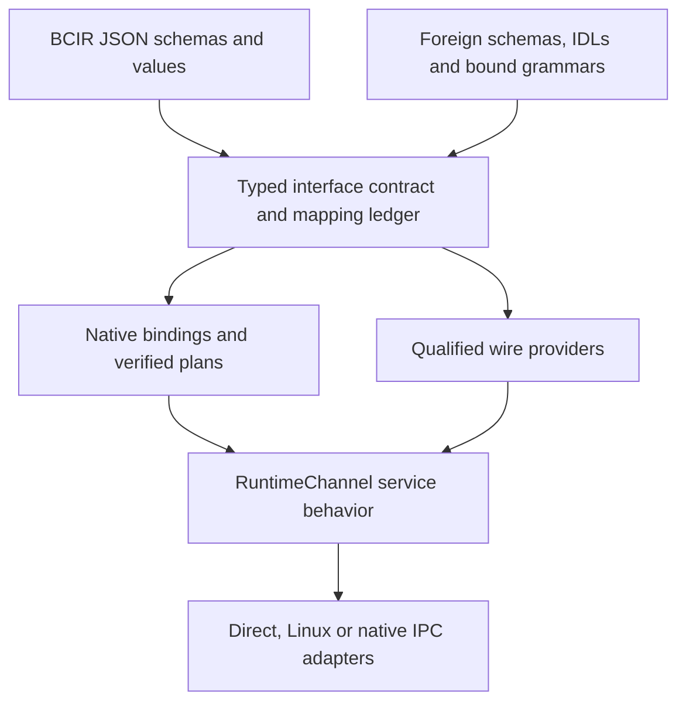

# BCIR universal serialization and interface roadmap

**2026-10-20 UTC. UDSI-PLAN design baseline: proposed integration, not implemented support.**

BCIR's universal application interface should connect typed service semantics, portable data,
native bindings and executable plans. A universal data serialization interface (UDSI) is the
interchange part of that program. It can give IPC, driver services, databases and ML ingestion
one contract registry while admitting several wire and memory representations.

**BCIR JSON can become the format-neutral schema/value/interface language for that registry.**
ASN.1 is its first implemented foundation and a future adapter, rather than a permanent
requirement that every foreign schema be rewritten as ASN.1. The new language and native JSON
frontend remain proposals; the existing implemented JSON rails keep their current semantics.

The first implementation target is a small, versioned RuntimeChannel service description,
projected through the existing ASN.1/JER machinery and one independently interoperable external
codec. Extend coverage through individually qualified adapters. Universal means extensible,
explicitly described compatibility; support remains a tested matrix of operations, types,
profiles, languages, targets and transports.

This roadmap owns the proposed UDSI work order. Existing [LangRef](BCIR_LANGREF.md),
[ASN.1/JER](BCIR_ASN1_JSON_ROADMAP.md), [artifact](kernel/BCIR_ARTIFACT_BUNDLE_ABI.md),
[driver/kernel](kernel/BCIR_DRIVER_KERNEL_ROADMAP.md) and
[C ownership](languages/C_MEMORY_DISCIPLINE.md) contracts retain authority. The
[backend/IPC test blueprint](research/BCIR_BACKEND_OPTIMALITY_AND_KERNEL_GATES_2026-10-20.md)
supplies OT/BG qualification gates. This document changes no frozen bytes, verifier laws,
calling convention, dependency or runtime behavior.

The [driver/IPC data and AI qualification report](research/BCIR_DRIVER_IPC_AI_QUALIFICATION_2026-10-20.md)
extends the useful-path tests through dataset/query, typed batches, buffer admission,
submission, compute, completion and checkpoint/result. Those workload measurements guide
IPC design and gate physical HAM/native HAM/SYCL. BCIR JSON describes typed contracts at
build/load/control or admitted ingestion boundaries; bulk tensors/columns can use qualified
binary projections, direct sinks or views without mandatory JSON materialization.

## 1. Reuse the implemented foundation

Baseline: BCIR main `12aa6dc5ba422418742f49e4bfc00aafdc17e07f` and documentation parent
`0a7bf7a309bfcb8c8a1157f9fa41bbe91a552240`. Pending #820 remains a separate training branch.
Implementation status below comes from those source trees, not from a proposed format list.

| Existing surface | Reuse and boundary |
|---|---|
| ASN.1 schema and encoding family | [Schema model](../bcir/asn1/schema.py), constraints, X.680 frontend, BER/DER, PER, OER, XER, JER and ECN on their documented subsets; Python/C coverage varies by rail |
| Format-neutral value stream | [Encode plan](../bcir/asn1/encode_plan.py) already feeds several schema-directed emitters identical values. Reuse its discipline; it is not a general foreign-schema IR |
| Bounded JSON and compiled plans | [JER plan](../bcir/asn1/jer_plan.py) and [JSON roadmap](BCIR_ASN1_JSON_ROADMAP.md) provide bounded source/control input and schema specialization. Read and write descriptors have different contracts and identities |
| Graph/program interchange | [Program projection](../bcir/asn1/program.py) and [JSON program roadmap](BCIR_JSON_PROGRAM_REPRESENTATION.md) already serialize BCIR program structure; extend through proved projections |
| Legal encoding selection | [Selection](../bcir/asn1/selection.py) and [certified tables](../bcir/asn1/certified.py) separate representability from measured cost. Their canonical-artifact rule remains intact |
| Direct service ABI | [RuntimeChannel v1](../runtime/c/bcir_runtime_channel.h): open, claim, map, submit, sync/cancel, event and close; generation-tagged handles and offsets; process-local, allocation-free hooks |
| Ownership and execution admission | [Pack handoff](kernel/BCIR_DATA_PLANE_HANDOFF.md), control/plan artifacts and live rings provide immutable generations, borrowed views and explicit backpressure; they do not implement generic network RPC |
| Limited Protobuf input | [SentencePiece reader](../bcir/frontends/models/spm.py) reads the fields its tokenizer needs. It is explicitly not a general Protobuf codec, IDL compiler or RPC stack |

The additional providers in section 4, ABNF/CSN.1 frontends, generic service-IDL compiler and
universal inter-process adapter are **planned**. Existing ASN.1 security-envelope structures
and integrity primitives do not establish complete CMS, PKCS or cryptographic-provider support.

## 2. Four compatibility contracts

| Contract | What it promises | Required evidence |
|---|---|---|
| Service/API contract | Method identity, typed arguments/results, effects, errors, ownership, order and lifecycle | Equivalent observable operations and refusal behavior |
| Portable data/wire contract | Exact profile, byte/bit order, widths, presence, framing, evolution and bounds | Independent codec interoperability and explicit representability |
| Native ABI binding | Target-specific calling convention, layout, alignment and local language/FFI glue | Compile/link/call tests on each supported target and language |
| Transport/deployment contract | Direct calls, hosted IPC, remote protocol or native service adapter | Authorization, delivery/order, completion, reset and resource-lifetime tests |

A portable message does not make an x86 binary executable on AArch64. POSIX remains an API
and behavior compatibility program; Linux binary compatibility remains architecture- and
syscall-specific. The [existing compatibility levels](kernel/BCIR_DRIVER_KERNEL_ROADMAP.md#72-compatibility-levels)
remain the support matrix. BCIR's interface layer can express native services beneath those
adapters and additional services beyond POSIX without changing existing syscall behavior.

### 2.1 One semantic contract, several realizations



The nodes are an integration design. A parser accepts only its own supported language;
ABNF and CSN.1 require explicit semantic bindings before becoming typed operations. A direct
call can use the generated local binding without serializing a request. A transported call
uses its endpoint's admitted wire profile. Bulk buffers can use a separately qualified view.

## 3. Interface description and registry design

Use the existing registry and generation model. Proposed descriptor field names below are
design concepts, not a new published wire schema:

- Stable interface, method, type and field identities, namespace and semantic version.
  Keep source schema ID/digest, mapping version, provider/profile ID and compiler identity.
- Primitive widths/ranges; text versus bytes; units, signedness, enum openness, union
  discriminants, list/count bounds, presence/default/null rules and extension policy.
- Distinguish ordered records/sequences from unordered maps and explicit graph references.
  Specify recursion/depth/node/reference limits and an actual memory bound or refusal.
- Method request/result/error types, read/write effects, aliasing and ownership transitions;
  synchronization, completion, cancellation, retry/idempotency and backpressure behavior.
- Required capabilities and permitted buffer roles. A handle value received from a peer is
  a name to resolve in that peer's authorized session, never authority by itself.
- Target ABI binding information stays target-specific. Transport/profile restrictions,
  maximum frame/in-flight sizes and availability are separately versioned.

Start with a small interface using RuntimeChannel's existing operations and statuses.
Generate optional C/C++ and hosted bindings from it; verify each against the direct reference.
The first bridge may use ASN.1 data types with a BCIR service/ownership sidecar. The longer-term
BCIR JSON frontend constructs the same typed contract directly, without requiring an ASN.1
source module. ASN.1 types alone do not specify a complete service lifecycle. A BCIR-authored
service description is a private BCIR interface language, with provenance to imported IDLs;
it does not acquire another standard's name or conformance claim.

### 3.1 BCIR JSON beyond the ASN.1 projection

Define BCIR JSON as a versioned, typed language with separate schema, value, service and
buffer-view document kinds. It can serve both as a portable data serialization and as compiler
input. ASN.1/JER supplies the initial source/inspection bridge; foreign schema importers and
the native BCIR JSON frontend can share a format-neutral typed model. A new BCIR JSON profile
is not X.697 JER and is not silently substituted for existing JER/program documents.

JSON supplies the carrier syntax. The BCIR specification supplies the meaning: preserve field IDs,
presence, bytes, arbitrary integers, decimal/float distinctions, signed zero/NaNs when required,
map-key types, extension tags, reference identity and source-specific semantics in the typed
contract and mapping ledger. Use explicit typed literals for values outside JSON's portable
primitive subset [J1]. Schema-known shorthand is possible only with a unique interpretation.
Refuse or preserve an opaque foreign value where a semantic mapping is missing. No silent
stringify, rounding, key conversion, flattening of graph identity or dropping of unknown fields.

Text is parsed and bounded once at build/load/control or admitted external-ingestion time,
then lowered to immutable typed descriptors, compiled codecs and existing execution machinery.
The same language can select a binary projection for a peer; native IPC submission, interrupt
and DMA paths retain their admitted compact records or buffer views. Using BCIR JSON to
describe a tensor does not require converting its elements into JSON text.

Keep existing JER read plans, write plans, ECN plans and their hashes unchanged. New foreign
descriptors have their own identities/versions. Reuse common analyses where semantics agree;
do not overload a landed descriptor so its meaning depends on the selected provider.

### 3.2 Directional mapping and three identities

For each source type and destination profile record whether conversion is exact, validated
under additional constraints, lossy with explicit application opt-in, opaque-only or unsupported.
Reader/writer compatibility is directional; do not equate matching type names with evolution.
Preserving the original foreign envelope may be necessary even when understood fields convert.

Maintain separate identities for:

1. The original wire octets and their provider/profile, with an exact-byte digest.
2. The typed semantic value under a declared schema, interpretation and canonical profile.
3. The compiled plan/artifact, bound to contract, mapping, target, provider and generation.

Protobuf deterministic serialization is not canonical across implementations/builds [F3].
Avro's parsing canonical form concerns schemas, not a universal canonical value encoding [A1].
BCIR's own canonical JER is a private profile, not a standard canonical JER variant.
Foreign protocol messages may have several legal byte spellings. Such messages belong to a
separate interoperability path; do not add them as canonical emit candidates to the existing
ASN.1 selector. A future canonical private profile needs its own explicit definition and tests.

### 3.3 One language, explicit projections

An illustrative proposed value document, **not an implemented parser format**, could be:

```json
{
  "format": "bcir-json",
  "version": 0,
  "kind": "record",
  "type": "example.Counter.v0",
  "fields": [
    {
      "id": 1,
      "value": {"kind": "integer", "type": "u64", "decimal": "18446744073709551615"}
    },
    {
      "id": 2,
      "value": {"kind": "bytes", "base64": "AQID"}
    }
  ]
}
```

The example omits the proposed schema/provenance envelope for readability. The declared type
would bind field meaning, bounds and mapping rules. The decimal string is an explicitly typed
integer literal; the bytes are explicitly encoded bytes. Their semantic types remain distinct
from ordinary strings. Ordered field entries have explicit IDs; duplicate handling is specified.
Native buffers, reference graphs, map keys and absent/null values need corresponding defined
constructs, not ad hoc conventions inferred by each backend.

After admission, an XDR provider might emit a supported integer/opaque record, a Protobuf
provider its mapped field-numbered message, and an ASN.1 provider its declared type projection.
Each mapping must prove the declared overlap and preserve extension/unknown-data policy.
The provider is selected from the peer's compatible set; unsupported values refuse or take
an explicitly agreed opaque envelope. An arbitrary existing peer cannot infer BCIR types.

Keep the semantic model authoritative across text and compact projections. Define deterministic
schema/value identity, ordering, numeric spellings, Unicode policy and version evolution.
Evaluate JCS only where its input/value restrictions fit [J2]; choosing sorted object keys alone
does not define semantic canonicalization. Learn from JSON Schema, JSON Type Definition and
JSON-LD [J3] for validation and references while specifying BCIR's own ownership/service and
execution boundaries.

The first independence gate is a small BCIR JSON contract/value loaded and bound directly
without calling the ASN.1 frontend, then independently encoded through two admitted providers.
Compare against the ASN.1-authored equivalent. New provider semantics use declared extensions
or refusals; they must not change an existing document's meaning. Native JSON, provider round trips and
typed/opaque refusals are SI-01/03/04 evidence, not a claim of universal support today.

## 4. Provider and frontend portfolio

Every new row is a proposal, not a dependency list to install in the core. Pin a specification,
implementation/version, supported subset, independent reference and actual workload before
implementation. Encode/decode, schema import, service import and zero-copy access are separate
capabilities. Expand one provider per reviewable slice.

| Family | Role and useful mechanism | Proposed integration and first gate |
|---|---|---|
| ASN.1 family and ECN | Existing constrained schemas and multiple transfer syntaxes | Reuse admitted types/plans; preserve current canonical/native artifact contracts |
| CSN.1 | Peer concrete bit-string notation described by 3GPP TS 24.007 Annex B [F1] | Separate frontend with bit-exact fixtures. Reuse ECN machinery only where equivalence is proved; never label CSN.1 an ASN.1 encoding |
| XDR | Portable external data representation and description language, RFC 4506 [F2] | First bounded interoperability candidate: fixed-width scalars, records, discriminated unions and bounded opaque/vector data; test required byte order/padding and refuse unsupported types |
| Protocol Buffers | Field-numbered wire data plus schema/version semantics [F3] | Optional descriptor/schema importer and encode/decode provider, initially a declared edition/subset. Presence, unknown enums/fields, oneofs and packed fields need independent tests |
| CBOR with CDDL | Tagged binary values and a schema-description notation [F4] | Explicit tag, map-key, duplicate and numeric policy; select a declared deterministic profile where needed. CDDL is a separate import/binding surface |
| FlatBuffers | Generated offset-based access to serialized tables [F5] | Compare validated borrowed access with full materialization. Gate buffer lifetime, bounds, alignment, default/presence and schema evolution; verify before access |
| MessagePack | Compact value types and application extension payloads [F6] | Register extension identity/meaning per profile; bound nesting/counts and declare map/numeric policies. No assumed universal canonical variant |
| SDXF | Structured Data eXchange Format documented by Informational RFC 3072 [F7] | Workload-gated chunk/type adapter with independent legacy corpus; Informational RFC publication is not an Internet Standard claim |
| Efficient XML Interchange | W3C EXI 1.0 Second Edition; schema-informed or built-in grammars [F8] | Optional XML/EXI event provider with declared schema/options, fidelity and limits. XER support alone does not implement EXI |
| Apache Thrift | Service IDL, typed data and generated RPC interfaces [A2] | Study/import a bounded service subset and one named protocol/transport; preserve exceptions/oneway/evolution semantics |
| Apache Avro | Writer/reader schemas and resolution for records/data exchange [A1] | Retain writer-schema identity and test reader/writer evolution and logical types; separate file/RPC/container support |
| Apache Arrow | Columnar layouts, IPC format and C Data Interface [A3] | Prefer a narrow C Data bridge for tabular ML buffers first. Its pointers/release callbacks are process-local; Arrow IPC or verified shared-buffer descriptors handle process boundaries |
| Apache Parquet; optional Arrow Flight | Columnar dataset storage; network data service [A4] | Parquet is a storage provider, not a tiny IPC record codec. Flight and its transport dependencies stay optional, with separate measured need and conformance |
| OGDL Binary | Existing OGDL Binary 1.0 text/binary graph representation [F9] | Implement the published format separately from a proposed BCIR typed graph profile; prove why existing ASN.1/ECN/program projections cannot meet the workload before inventing new bytes |

### 4.1 Rich graph data without claiming undeclared OGDL compatibility

OGDL Binary already exists. Its published model distinguishes UTF-8 text from binary nodes;
additional types belong at a higher layer [F9]. Begin with exact OGDL Binary interoperability.
A richer BCIR profile would specify type/schema IDs, ordered edges, explicit node IDs/references,
cycle/alias policy, bounds, extension policy and deterministic identity.

Define whether shared references and cycles are admissible data and how they are encoded.
Do not infer object identity from equal content or reconstruct unbounded recursion. Graph data
does not become executable BCIR simply by naming an operation: importing a program still uses
the ordinary verifier/admission pipeline.

A typed convention layered over valid OGDL needs a named BCIR profile and peer agreement.
An incompatible wire extension needs a distinct format identity and version. Neither is
automatically readable by an ordinary OGDL implementation. Defer a new binary format until
representability, size/access cost or required graph behavior demonstrates a gap.

## 5. IPC: the service contract above the selected transport

The direct RuntimeChannel remains the behavioral source of truth. Its hook table contains
process-local function/implementation pointers; those are never serialized. A future adapter
marshals authorized handles, generations, offsets, lengths, sequences and typed statuses.

Choose a small explicit bootstrap profile with bounded framing. Endpoint setup binds interface,
schema/mapping/profile versions, required features, peer/session identity, limits and the
delivery policy. Fixed-format endpoints may be configured out of band. Reject incompatible
required features; no format guessing or silent profile downgrade. Negotiation itself must have
a bounded parser and the endpoint's authentication/authorization policy.

For each transported call bind method/contract, request correlation, session/generation,
sequence, payload length and optional external-buffer descriptors. Specify partial reads,
duplicate delivery, completion, cancellation, timeout, peer death, reset and reconnection.
Retries of a submit cannot become duplicate device work merely because serialization succeeded.
Transport-specific capability transfer needs a local authorization/handle-table operation;
copying a numeric handle between machines does not transfer ownership.

Use two data paths:

- Small control records use an agreed codec or specialized fixed layout. Generate the codec
  once and cache validated descriptors; avoid schema negotiation or generic JSON parsing per call.
- Large tensors/columnar/packet data use admitted buffer mappings, offset/length descriptors
  and completion-driven lifetimes. Copy/convert explicitly when layouts, byte order, ownership,
  isolation or DMA/coherency domains require it. A shared mutable buffer needs a pin/freeze or
  copy strategy that prevents post-validation mutation from changing the admitted request.

Linux hosting retains the canonical initial adapter: bounded Unix SOCK_SEQPACKET control,
memfd/mmap shared storage and eventfd/epoll notification. A native adapter implements the same
supported method/error/lifecycle contract using its own services. Wire formats may differ when
values/traces agree; exact-byte parity is required only for a declared shared wire profile.
The universal interface program does not freeze UAPI v1 ahead of UART and virtio evidence.

Arrow C Data can avoid materialization within one process while respecting its release protocol.
Its C pointers and callbacks must terminate at the local adapter. Cross-process and device
sharing need a qualified IPC/shared-memory/device ownership path; a zero-copy format label
cannot supply it [A3].

## 6. ABNF and internet protocol interfaces

Add an optional RFC 5234 grammar frontend with RFC 7405 case-sensitive strings [N1].
It should compile a supported grammar into a bounded incremental parser or validator, with
source positions, exact octet consumption, output capacities and declared complexity limits.
Rules using unsupported recursion/ambiguity or externally defined prose values require
explicit bindings or refusal; never silently reinterpret ABNF alternatives as ordered PEG choice.

ABNF specifies syntax. Add a semantic binding from productions to typed fields/methods, then
a separate protocol state machine for legal message order, framing, authorization and retries.
A valid production alone establishes neither a valid service request nor internet interoperability.
Use an existing transport/protocol specification where appropriate; define any BCIR-private
protocol and negotiated version explicitly.

First fixtures should exercise a bounded control envelope, core rules and %s/%i strings,
numeric terminals, CRLF, repetitions and split/truncated input. Match an independent parser
over the admitted subset. Define incomplete versus invalid input, backpressure and byte/depth
limits. CSN.1 handles bit-string layouts in a separate frontend; ABNF is not a replacement for
its semantics or an automatic ASN.1 schema converter.

## 7. Cryptographic syntax and provider integration

ASN.1 is important infrastructure for cryptographic objects. Parsing DER or an ITS security
envelope is distinct from checking a signature, encrypting data, managing keys or establishing
trust. Extend through optional established cryptographic providers with explicit algorithm/key
policies and independent fixtures; keep codec and cryptographic-operation status separate.

| Proposed surface | Initial scope and promotion evidence |
|---|---|
| CMS, RFC 5652 | Import/emit a declared SignedData subset first; verify content, attributes and algorithm parameters with a reference provider before claiming signature verification. EnvelopedData is a separate encrypted-message slice |
| PKCS #8 / RFC 5958 | Bounded key-container interpretation and provider handoff; encrypted key handling, key ownership, persistence and permissions declared separately |
| PKCS #1 / RFC 8017 | RSA key/algorithm encodings and provider operations under a named policy; syntax coverage does not implement RSA primitives |
| PKCS #12 / RFC 7292 | Optional key/certificate exchange container, workload-gated after simpler objects; independently test password/integrity/encryption behavior and compatibility |

For signed foreign data retain the original envelope/bytes and verify the standard-defined
signature input before any semantic transcode. CMS has specific signed-attribute DER and
tagging rules; generic BER-to-DER or JSON normalization is not its verification algorithm [C1].
Re-encoding an object does not preserve its signature automatically. Secret-bearing diagnostics
and inspection views must follow the provider's exposure policy; do not make JER export of
private keys an implicit operation.

Reuse [plan-signature](kernel/BCIR_PLAN_SIGNATURE_ABI.md) and
[artifact](kernel/BCIR_ARTIFACT_BUNDLE_ABI.md) contracts for internal activation. CRC, content
hashing, HMAC, asymmetric signing and peer authentication retain distinct meanings. Adding CMS
syntax changes none of their current support claims. ASN.1/ABNF parsing never confers execution
authority; device/service capability admission remains required.

## 8. Compiler, ML and TMSAO integration

Represent an admitted conversion as explicit work: validate/decode, map/convert, pack/copy,
transfer, compute and encode/return. Include schema/profile identity, buffer read/write effects,
alignment, bounds, lifetime and target constraints. Initially use existing supported provider
and opaque-region mechanisms; do not declare a new executable MLIR region implemented here.

Select among semantically admissible profiles accepted by the peer. Wire compatibility,
canonicality requirements and ownership constrain the candidate set before cost. Reuse the
twelve-axis K_BCIR model and its calibration discipline; no new cost axis is needed merely
because a format is new. Bind measurements to workload, schema, provider version, target and
collection availability.

Optimize total useful-path cost: parse/validation, schema load/compile, encode/decode, copy,
packing, synchronization, transfer and consumption. A low-level codec win may disappear when
the consumer requires a different layout. Measure specialized endpoints as well as generic
dispatch so a provider wrapper cannot hide its overhead.

Generate direct source-to-destination transcoders or typed streaming sinks from the common
model, with bounded scratch and explicit semantic checks. Conversion need not materialize
an intermediate JSON document or complete value graph. A validated identity/borrowed-view
route is another candidate when its layout and lifetime contract permits it; include the
validation cost and prove the observed bytes stay bound to that validation.

Test profitable combinations: decoder-to-typed sink, columnar-to-native batch, validated
borrowed views, producer-written tensor panels, shared pack lifetimes, and control-record
batching. Preserve required validation and semantics. Compare optional transformations on/off
through the same backend and inspect actual calls/buffers; introduce new IR operations only
when the semantic/analysis need and applicable [admission criteria](research/BCIR_BACKEND_OPTIMALITY_AND_KERNEL_GATES_2026-10-20.md#6-admission-of-new-ir-operations-and-pre-llvm-transformations)
justify them. Any changed legality is implemented on the oracle and MLIR law rails together.

For ML, compare a resident native batch with the complete ingestion path. Time ASN.1/Protobuf/
Arrow parsing where used; include null masks, string/dictionary conversion, shape/stride
validation and device transfer. Serialization efficiency does not establish faster matmul.
Retain separate eager/compiled PyTorch comparisons and real-device Triton qualification.
Full comparative model training remains deferred until #820 completes and merges.

## 9. Gateable implementation order

These are planned program milestones. Each provider/frontend is a separate reviewable slice;
the list is not a request to implement every format in one PR.

| Milestone | Deliverable | Required exit / relationship |
|---|---|---|
| UDSI-0 | Coverage/mapping ledger, contract/profile identity and compatibility policy | SI-01/03/04; BG0. This document proposes the design, not an executable descriptor |
| UDSI-1 | Minimal native BCIR JSON contract/value frontend, equivalent ASN.1/JER bridge and generated local C binding | SI-01/02/04/05; direct loopback parity plus the ASN.1-independent frontend gate, preserving existing formats and ABI |
| UDSI-2 | First foreign provider: bounded XDR control-message profile | Independent peer encode/decode, golden bytes and exact supported-type mapping; SI-01/02/03/06 |
| UDSI-3 | CBOR/CDDL then Protobuf interoperability, in separate slices | Presence/unknown/tag/evolution corpus and canonical-versus-foreign identity separation; SI-01/03/06 |
| UDSI-4 | Transport adapter over the qualified direct contract | SI-05/07/08 and OT-15/16; loopback lab first, UART/virtio D/M evidence before Linux/native UAPI freeze |
| UDSI-5 | Arrow C Data batch bridge; FlatBuffers borrowed-view candidate when useful | SI-06/07/10; OT-06/12. Actual buffer ownership and consumer-layout benefit, not only decode rate |
| UDSI-6 | ABNF grammar/binding frontend and CSN.1 bit-layout frontend, separately | SI-08/11; protocol/bit-exact independent fixtures and explicit unsupported constructs |
| UDSI-7 | CMS and selected PKCS provider integration, one object/operation subset at a time | SI-09; independent verification, exact signature-input rules and key-lifetime policy |
| UDSI-8 | OGDL Binary interoperability; optional typed graph profile only on demonstrated need | SI-12 and SI-01/02/06; separate format/profile identities and bounds |
| UDSI-9 | Workload-selected MessagePack, Avro, Thrift, EXI, SDXF and storage/network adapters | Per-provider contract and conformance plus SI-06/10; no obligation to add idle dependencies |

UDSI-0/1 and optional hosted interoperability can proceed alongside PX-2/PX-3 native training
work. Driver bring-up remains the canonical BG3–BG6/D/M program. Native IPC and independent
boot add deployment/ownership obligations; they do not wait for every format or a blanket
framework performance victory. Broader formats may move earlier when a real client requires
them and their entry gates pass.

## 10. Conformance and performance qualification

All SI experiments below are **planned**. This update runs no new codec, IPC, cryptographic
operation or model-performance benchmark.

| Test | Required controls and evidence |
|---|---|
| SI-01 — representability | Shared abstract fixtures for each declared overlap; encode with each side, decode with the other. Distinguish semantic round trip, exact wire retention and explicit loss/refusal; independent references avoid two BCIR rails sharing the same bug |
| SI-02 — bounds and refusal | Byte/count/depth/reference/work/output limits; truncation, overflow and malformed field/offset/type cases; transactional failure and required-capacity reporting. C sanitizer/fuzz/fail-allocation coverage appropriate to its memory class |
| SI-03 — evolution | Old/new writer and reader matrix, absence/default/null, enums/unions, reserved IDs, unknown fields and extensions; incompatible required features refuse; preserve declared forwardable opaque content |
| SI-04 — generated interface/ABI | Native BCIR JSON and ASN.1-authored equivalents produce matching typed contracts; native frontend works without ASN.1 compilation. Deterministic descriptors/bindings, target-specific layout/call tests, portable golden bytes and pinned identities; no cross-ISA native-binary identity claim |
| SI-05 — service/IPC traces | Same methods and effects through direct, serialized loopback, Linux and eventual native adapters; status/order, duplicate/retry, cancellation, timeout, reset, peer death, stale generations, saturation and completion-driven release |
| SI-06 — codec and useful-path frontier | Same values/validation/consumption work: small controls, bounded nested records, bit-packed messages and columnar batches. Cold schema/compile and warm encode/decode/access separately; bytes, peak live storage, allocations/copies, throughput, p50/p95/p99 and uncertainty |
| SI-07 — buffer views | Validate/pin versus copy, alignment/endian/layout compatibility, Arrow release protocol, mutation/lifetime tests and actual copy counts. Exercise process/device boundaries only on qualified transports; local pointer sharing is not wire IPC |
| SI-08 — negotiation and stream parser | Fragment every boundary, concatenate frames, inject incompatible versions/limits/profiles and partial headers; bound bootstrap parsing, distinguish incomplete/invalid, preserve endpoint authorization and resist silent downgrade |
| SI-09 — crypto interoperability | Provider-backed positive/negative CMS/PKCS fixtures; content/attribute/parameter changes, wrong keys and unsupported algorithms; preserve required signature input. Report syntax-only versus verified/decrypted operations separately |
| SI-10 — compiler/ML integration | Same ingestion-to-consumer workload with pass/provider on/off, same native compute, quality/state and memory contract; include cold setup and held-out shapes. OT-04/06/12/14 attribute plan, lifetime and telemetry effects |
| SI-11 — grammar/bit layout | RFC 5234/7405 core cases and declared CSN.1 constructs, independent accept/reject agreement, bit-exact fixtures, bounded recursion/ambiguity and semantic/state binding; syntax success alone cannot execute a method |
| SI-12 — graph interchange | Published OGDL bytes and a separate BCIR-profile corpus: order, binary/text typing, references, cycles if admitted, duplicates, depth and unknown extensions. Exact identity/loss policy and deterministic supported-profile round trips |

Use the existing [paired measurement protocol](research/BCIR_BACKEND_OPTIMALITY_AND_KERNEL_GATES_2026-10-20.md#10-reproducible-result-and-passfail-policy):
pin source/toolchain/profile/target, randomize paired rounds, report cold/warm and independent
sessions, retain raw records and compare identical work. Full consumption, selected-field
access and structural indexing are different tasks. Name the independent provider and
validation settings; do not compare an unchecked view with a validating materializing decoder.

Separate codec CPU time from queueing/notification and the complete request critical path;
preserve isolation requirements in OT-15. Memory includes owned live buffers, arenas, retained
foreign wire/unknown fields, mappings and in-flight storage. PMU/energy/device/native timings
require real available instrumentation; QEMU conformance is functional evidence.

The useful first demonstration is one interface, two independently conforming representations,
identical direct/transported behavior and a measured total-cost frontier. Broader portability
and performance claims grow only with that support matrix.

## Source ledger

Primary standards/project documentation checked 2026-10-20 UTC. These establish mechanisms,
not measured BCIR support or a ranking of codecs.

- **[F1]** [3GPP TS 24.007 / ETSI TS 124 007 V19.5.0, Annex B](https://www.etsi.org/deliver/etsi_ts/124000_124099/124007/19.05.00_60/ts_124007v190500p.pdf).
- **[F2]** [XDR, RFC 4506 / STD 67](https://www.rfc-editor.org/rfc/rfc4506.html).
- **[F3]** Protobuf [wire encoding](https://protobuf.dev/programming-guides/encoding/),
  [schema/language guide](https://protobuf.dev/programming-guides/proto3/) and
  [serialization is not canonical](https://protobuf.dev/programming-guides/serialization-not-canonical/).
- **[F4]** [CBOR, RFC 8949](https://www.rfc-editor.org/rfc/rfc8949.html) and
  [CDDL, RFC 8610](https://www.rfc-editor.org/rfc/rfc8610.html).
- **[F5]** [FlatBuffers internals](https://flatbuffers.dev/internals/).
- **[F6]** [MessagePack specification](https://github.com/msgpack/msgpack/blob/master/spec.md).
- **[F7]** [SDXF, RFC 3072](https://www.rfc-editor.org/rfc/rfc3072.html).
- **[F8]** [W3C EXI 1.0 Second Edition](https://www.w3.org/TR/exi/).
- **[F9]** [OGDL Binary 1.0](https://ogdl.org/spec/binary.html).
- **[A1]** [Apache Avro 1.12.0 specification](https://avro.apache.org/docs/1.12.0/specification/).
- **[A2]** [Apache Thrift IDL](https://thrift.apache.org/docs/idl).
- **[A3]** Arrow [C Data Interface](https://arrow.apache.org/docs/format/CDataInterface.html)
  and [columnar/IPC format](https://arrow.apache.org/docs/format/Columnar.html).
- **[A4]** [Apache Parquet overview](https://parquet.apache.org/docs/overview/) and
  [Arrow Flight](https://arrow.apache.org/docs/format/Flight.html).
- **[N1]** [ABNF, RFC 5234](https://www.rfc-editor.org/rfc/rfc5234.html) and
  [case-sensitive strings, RFC 7405](https://www.rfc-editor.org/rfc/rfc7405.html).
- **[C1]** [CMS, RFC 5652](https://www.rfc-editor.org/rfc/rfc5652.html).
- **[C2]** [PKCS #8 / RFC 5958](https://www.rfc-editor.org/rfc/rfc5958.html),
  [PKCS #1 / RFC 8017](https://www.rfc-editor.org/rfc/rfc8017.html) and
  [PKCS #12 / RFC 7292](https://www.rfc-editor.org/rfc/rfc7292.html).
- **[J1]** [JSON, RFC 8259](https://www.rfc-editor.org/rfc/rfc8259.html).
- **[J2]** [JCS, RFC 8785](https://www.rfc-editor.org/rfc/rfc8785.html).
- **[J3]** [JSON Schema 2020-12](https://json-schema.org/draft/2020-12/json-schema-core),
  [JSON Type Definition, RFC 8927](https://www.rfc-editor.org/rfc/rfc8927.html) and
  [JSON-LD 1.1](https://www.w3.org/TR/json-ld11/).
