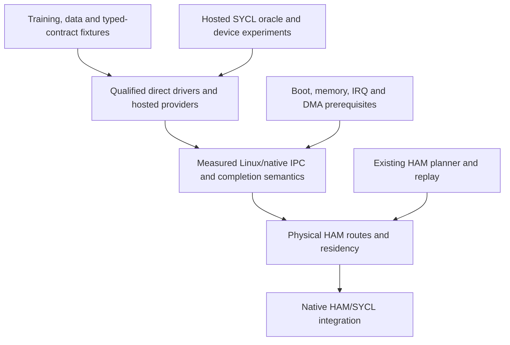

# BCIR driver and IPC qualification for data science, training and inference

**2026-10-20 UTC. Analysis and proposed qualification specification; no new device, IPC or model-performance measurements.**

BCIR's training backend and data infrastructure should supply the workloads that qualify its
drivers and shape its IPC. Each driver must prove its own serialization, structure, ownership
and lifecycle contract. Compute devices must additionally prove the inference and training
paths they actually support. The resulting evidence should guide kernel/IPC optimization and
then physical Hierarchical Access Memory (HAM) and native HAM/SYCL integration.

This is the remaining extension of draft [PR #821](https://github.com/Mecca-Research/Binary-Correspondence-Intermediate-Representation/pull/821).
It uses the existing [D/M driver ladder](../kernel/BCIR_DRIVER_KERNEL_ROADMAP.md),
[OT/BG backend gates](BCIR_BACKEND_OPTIMALITY_AND_KERNEL_GATES_2026-10-20.md),
[UDSI/SI interface program](../BCIR_UNIVERSAL_INTERFACE_ROADMAP.md),
[training ladder](BCIR_TRAINING_ACCELERATION_ROADMAP.md) and
[HMF-D0–D5 hardware gates](../kernel/BCIR_HAM_MEMORY_FABRIC.md#9-driverkernelfirmware-sequence).
It adds workload requirements to those gates, rather than introducing another execution
engine, driver API, cost model or independent milestone numbering scheme.

## 1. Current source and continuity evidence

| Source | Inspected identity | What it establishes |
|---|---|---|
| BCIR main | `12aa6dc5ba422418742f49e4bfc00aafdc17e07f` | Native CPU training/inference, codecs, planning, telemetry and direct RuntimeChannel foundations; no resident hardware driver, Linux/native IPC or physical HAM adapter |
| PR #821 documentation parent | `954da6ed5189a830c90f9382170fdb8b2ddc4e4a` | Triton/PyTorch comparison, the retained experimental CPU pilot and proposed OT/BG/UDSI/SI programs |
| Pending PR #820 | `b6c50f11d5ed2d18bd7b7cae026547b93db235fe`; open, draft, unmerged | GEO-3 exact BF16 workspace/per-layer recomputation, PX-1 launch witness, PX-2a checked launch-program execution, PX-2b StreamPack/ExecutionPlanV1 lowering and execution |
| Earlier Library research | Training architecture blueprint, 2026-10-13; PR #818 geometric-head report, 2026-10-18 | Prior requirement to connect executable plans, buffer lifetimes and measured full workloads; hardware/numerical-contract dependence of observed results |

The pending branch's [native pack model](https://github.com/Mecca-Research/Binary-Correspondence-Intermediate-Representation/blob/b6c50f11d5ed2d18bd7b7cae026547b93db235fe/bcir/hosted/models/native_pack.py)
states one claim per kernel call and value lifetimes. Its
[C lowering contract](https://github.com/Mecca-Research/Binary-Correspondence-Intermediate-Representation/blob/b6c50f11d5ed2d18bd7b7cae026547b93db235fe/runtime/c/bcir_decoder_pack.h)
checks the pack/plan and derives the launch program from their operations and operand spans.
These are source-inspected implementation changes on #820, not main features or measurements
reproduced here. The PR author reports 356 matching pack/program/state runs. PX-3 measured
per-call selection, PX-4 lifetime placement and PX-5 GF(2) layouts remain open at this pin;
entering that phase does not mean completing it. PX-6 remains a real-device gate.

Retain the original CPU pilot's pins and results. Full comparative model training remains
**deferred until #820 completes and merges**; then freeze the actual merged source and rerun.
Neither older AMD fallback results nor #820's Intel-host measurements establish a result for
Snapdragon, a GPU, a native kernel or this new qualification program.

### 1.1 What the database foundation actually is

The training rail already has a [database layer](../../training/tools/db/): catalog generation,
parts/content identities, predicate/plan selection, retrieval and relational/analytical tools.
Its [database gate](../../training/tools/verify_database.py) checks both answer equivalence
and whether pruning, late materialization, derived-column reuse and kernel caching actually
remove the claimed work. This is useful methodology and an available workload source.

It belongs to `training/`, not the freestanding IR/kernel. Export pinned datasets, queries,
result digests and traces as data fixtures or optional hosted inputs. Preserve the
[one-way corpus law](BCIR_TRAINING_ACCELERATION_ROADMAP.md#5-the-one-way-corpus-law):
do not import those tools into `bcir/`, `mlir/` or `runtime/`, or make kernel correctness
depend on the teaching corpus. This foundation is not a production distributed database.

## 2. Make AI workloads part of driver qualification

For each concrete device/provider/firmware/OS combination, publish a capability and workload
matrix. A vendor name alone is not a target. Record supported operations, dtypes and
accumulation contracts, shapes/layouts, gradients, optimizer ownership, memory domains,
transfer routes and events. Distinguish **planned**, **unavailable**, **unsupported**,
**qualified on this target** and **regressed**. Unsupported training is an explicit refused
capability; it is not a passing training test.

The first driver package remains UART. Hosted compute-provider research can advance in
parallel using existing runtimes. Every new driver adds the applicable rows below to its
normal structure/codec/lifecycle suite before its D7/M9 workload promotion.

| Driver or resource class | Required data and lifecycle workload | Applicable AI workload | Boundary |
|---|---|---|---|
| UART / console | Bounded records, partial arrivals, framing, ordering, saturation, loss accounting, cancel/reset and stale handles | Carry a deterministic telemetry or dataset fragment to a host consumer when useful | No full training/inference on the UART; downstream host compute is labeled separately |
| Storage / NVMe / virtio-blk | Query/data read batches, declared alignment, DMA-visible ownership, checkpoint writes, restart/corruption and durability ordering | Feed the same model batches; checkpoint and restore the same state | Storage correctness and durable completion are distinct from model-kernel correctness |
| NIC / virtio-net / transport | Variable message sizes, batching, backpressure, reorder/duplicate/refusal policy, cancellation and peer death | Dataset/result transport; later independently qualified distributed exchanges | An operational network driver does not establish collectives or distributed training |
| Intel or AMD CPU target | ISA/OS-feature admission, tensor/column layouts, alignment/tails, NUMA/thread/scratch budgets and arithmetic identity | Supported native inference plus full forward/backward/clip/optimizer/checkpoint steps; longer learning run for promotion | CPU training and its bindings are distinct from a GPU/NPU driver, even on the same system |
| Intel / AMD / other GPU target | Named supported runtime/provider, real image identity, residency, transfer/event dependencies, cancellation/reset and isolation | Inference, then full training only after required forward, VJP and optimizer coverage exists | Report every host/library fallback and transfer; no inference-only path labeled device training |
| Snapdragon / other heterogeneous SoC | Separate CPU, GPU and NPU identities; shared/imported-memory ownership, coherence and completion contract, contention and thermal behavior | CPU baseline; GPU/NPU inference as supported; training only on explicitly qualified paths | ARM64 CI or an NPU inference result does not qualify the whole SoC for training |
| Shared-memory / future IPC service | Authorized mappings, leases/generations, bounded queues, completion-before-reuse, delayed consumers and teardown | Exercise each qualified data/inference/training profile through the service | Process-local direct hooks and host fallback stay separately labeled |

Every applicable row has a positive fixture and meaningful negative cases. Device absence is
**unavailable**; a known supported path that fails is a **failure**. A driver with only its
structure/lifecycle tests may be qualified for that limited function, but cannot receive an
unexecuted AI capability. An optional provider's work retains its provider identity.

## 3. One evidence chain from dataset to result or checkpoint

The proposed chain is:

**dataset/query → typed values or batch views → admitted buffers → selected plan → submission
→ executed compute → completion/visibility → consumer or durable checkpoint.**

Each edge must retain enough identity to join the records without treating a name, raw
pointer, model file hash or elapsed time as proof of another edge.

| Boundary | Evidence to retain | Failure to expose |
|---|---|---|
| Dataset/query | Snapshot/part/schema and split identities, predicate/projection, row order, tokenizer/transform versions, expected output digest | Scanning another dataset, changing batches or silently reordering records |
| Decode/materialize | Input and semantic digests, exact codec/profile/mapping, bytes read/written, temporary allocations, skipped work and bounds | A fast decoder that moves materialization or coercion outside the timer |
| Buffer admission | Resource/bank ID, session/generation, offset/length/alignment/strides, access rights, owner and lifetime | Unchecked imported handles, live alias, stale mapping or hidden bounce buffer |
| Plan and submission | Recipe/contract, plan/pack/image/provider IDs, dependencies, queue/batch size and submission sequence | An optimizer decision that never reaches the executed path |
| Compute and completion | Actual image/call/operation/shape and fallback, event/sequence, clock domain, visibility/ownership release and trace-loss accounting | Host enqueue time presented as device completion; storage reused before completion |
| Result/checkpoint | Output and full state digests where required, optimizer/RNG/data cursor, model quality; checkpoint publication/recovery/durability policy | Lost updates, unresumable checkpoints or compute completion presented as durable storage |

This is a proposed evidence association, not a new frozen wire schema. Reuse existing registry
IDs, StreamPack/ExecutionPlan, [telemetry envelope](../kernel/TELEMETRY_ENVELOPE_ABI.md),
[live ring](../kernel/BCIR_LIVE_RING_ABI.md) and
[control-plane generations](../kernel/BCIR_CONTROL_PLANE_ABI.md). The complete cross-service
join is not implemented by this report. Trace loss must be counted; clocks need a stated
correlation/error policy before comparing timestamps across devices or services.

Follow the database gate's two-part test: verify the answer/state **and** verify the proposed
mechanism. If a new plan removes a copy, rematerializes a layer, batches submissions or reuses
a pack, demonstrate that change in the trace and owned-byte inventory. State parity alone
cannot prove reduced work, and fewer calls alone cannot prove equivalent state.

## 4. What the kernel IPC should optimize

Treat TMSAO as a constrained, target/workload-specific optimization program. Keep K_BCIR's
existing cost vector, legality rules and candidate/provenance machinery. Record the objective
and limits before searching: throughput, tail latency, peak owned memory, power/thermal budget,
isolation, reliability and model-quality requirements can conflict.

For a request, measure `T_end_to_end = t_required_completion - t_input_ready` at a declared
boundary. For durable training checkpoints, required completion includes the selected storage
durability contract; for inference it may end when the consumer can safely read the result.
Compute overlapping stages from the dependency graph and critical path. Do not add their
durations as if asynchronous work were serial. Report steady-state throughput under the same
memory and latency limits, plus cold load/compile and checkpoint/recovery costs separately.

Inference profiles separate model load, prefill and decode, reporting time to first token,
per-token latency and completed requests/tokens per second at stated arrival/concurrency
and batch policies. Retain enough samples for the selected p50/p95/p99 estimates and their
uncertainty. Training profiles report accepted updates and supervised tokens per second,
time to a declared held-out quality level, effective/micro-batch and accumulation, and
checkpoint/recovery overhead. Data profiles report rows/bytes per second and query-to-batch
latency with exact output semantics. Padding, dropped requests and failed updates never
inflate useful throughput. A short single-request latency win is not a saturated serving win.

| Workload observation | IPC/driver candidate to test | Costs and semantics to preserve |
|---|---|---|
| Small requests spend time crossing service/queue boundaries | Bounded batch descriptors, reusable admitted requests, fewer redundant transitions | Batch-fill latency, fairness, authorization, cancellation granularity and bounded verification |
| Tensor/column conversion and copies dominate | Qualified typed views, resident buffers, explicit imports or direct codec-to-consumer sinks | Alignment/layout, lifetime, pin/register/map cost, real copy count and delayed completion |
| Device gaps coincide with input starvation | Bounded prefetch/double buffering and overlap of read/decode/transfer/compute | Whole-pipeline peak capacity, contention, rollback and dependencies |
| Many tiny notifications consume CPU | Event aggregation, completion batching or an admitted polling/wait policy | Tail latency, cancellation, peer death, CPU/energy cost and fairness |
| Memory pressure triggers recompute or extra transfers | Joint workspace/packing/lifetime/queue-depth selection | Same numerical contract, actual live bytes and full update time |
| Query pruning reduces downstream payload | Predicate/projection pushdown and late materialization through a declared data source | Exact row/result semantics, source snapshot, bytes actually avoided and downstream layout |
| Checkpoints pause training | Bounded snapshot/staging or incremental publication where valid | Consistent weights/moments/cursor, capacity and durable recovery under failure |

These are candidates, not IPC features already implemented or assumed wins. Keep descriptor
submission and buffer transfer distinct. Small control messages may be copied; a bulk view
may avoid payload serialization but still pay mapping, cache, synchronization or staging
cost. "Zero-copy" requires measured movement and ownership evidence on the declared route.

Use the same numerical kernel/image for direct-versus-IPC comparisons whenever possible,
including the same initialization, shape and device state. Then compare complete stack choices
separately. Direct execution isolates service cost but does not necessarily provide the
protection/authorization guarantees of an IPC service; equalize those obligations or disclose
the difference. Retain stock hosted/vendor paths as baselines under BG6.

### 4.1 Numerical and learning gates

Within an exact arithmetic contract, compare outputs, gradients, clipping, weights and moments
bit for bit where promised. Across different admitted contracts, predeclare numerical bounds
and quality criteria. Keep model/initialization, batch/token order, effective batch, optimizer,
update count and evaluation/checkpoint selection comparable; accumulation/reduction changes
may alter the state even at the same effective batch.

Use a bounded short step/gradient/resume fixture in routine regressions. Before promoting a
training or inference capability, also run its declared complete workload and held-out quality
test. Longer model comparisons require suitable hardware and the merged #820 pin. A kernel
speedup or a successful training loss decrease alone does not establish useful model quality.

## 5. BCIR JSON and universal serialization have two roles

The [UDSI roadmap](../BCIR_UNIVERSAL_INTERFACE_ROADMAP.md) already proposes a format-neutral
typed BCIR JSON language, with ASN.1/JER as the first bridge. Use that language to describe
schemas, services, batch views, buffer effects and admitted codec profiles at build/load/control
boundaries. Compile or parse once into bounded immutable descriptors when their contract
allows reuse. The new native BCIR JSON frontend and foreign providers remain planned.

Bulk tensor and column payloads need not become JSON text. Direct typed sinks, admitted binary
projections and qualified local/imported views should be compared with materialized JSON on
the same semantic workload. Measure read/decode/convert/map/consume together, including bounds
checks and provider/framework staging. Retain original-wire, semantic-value and compiled-
artifact identities separately. ASN.1/JER and existing program JSON retain their meanings.

The [RuntimeChannel v1 header](../../runtime/c/bcir_runtime_channel.h) already defines a
**process-local, allocation-free direct hook ABI**, with externally serialized operations and
generation-tagged handles/offsets. Its vtable, implementation pointer and local callbacks do not
cross IPC. A future adapter resolves transported names in an authorized session and preserves
order, completion, cancellation, reset and resource lifetimes. Do not turn the existing SPSC
telemetry ring into an unqualified multi-producer command transport or change v1's reserved
fields/flags to carry a new protocol.

The universal format and IPC therefore reinforce each other through typed contracts and
measured code generation. They do not imply that one textual representation, binary layout
or transport is fastest for every workload. "State of the art" remains a comparative target
to demonstrate through OT-12/15/16 and SI-01–SI-12, not an implementation status.

## 6. Workload experiments to attach to the existing gates

**Every row below is planned.** Reuse existing harnesses and independent references when
implementing the runners; this report adds no executable test commands or performance results.

| Workload experiment | Existing gates | Required evidence |
|---|---|---|
| Serial/console fixture | D0–D3, BG3/4; OT-14/15/16; applicable SI bounds/semantics | Same bounded byte/record stream through simulator, direct and hosted adapter; saturation, partial records, cancellation, loss and reset |
| Data/query-to-batch | OT-12/13/15; SI-01/02/06/07/10 | Pinned query/snapshot, identical rows/batches, measured pruning/read/materialization/conversion bytes, buffer lifetimes and consumer correctness |
| CPU reference train/infer | BG0/1; OT-01/03/04/05/06/10/13 | One complete short inference/training/resume fixture; exact state under its contract; trace-to-plan linkage and memory inventory |
| GPU/SoC capability ladder | BG2, D7/M9; OT-01/03/07/08/09/10/12 | Named real target/provider, admitted forward/VJP/optimizer subset, actual image and fallback, numerical/quality checks and supported transfer routes |
| Same-image direct/Linux/native IPC | BG4–BG7; OT-14/15/16 | Same admitted work and protection scope, end-to-end and tail timing, submission/completion counts, CPU cost, live memory, generation and failure behavior |
| Concurrent inference and training | BG6/7; OT-10/12/13/14/16 | Throughput at stated tail-latency/quality bounds, contention/thermal behavior, fairness, bounded queues and no starvation or state contamination |
| Checkpoint/restart/failure | D/M lifecycle gates; OT-03/12/13/16; SI-02/06 | Consistent snapshot, durable publication, corruption/refusal, cancellation/device/peer death, restart and stale-generation rejection |
| Future physical HAM/SYCL route | M10, applicable HMF-D gates; BG2/6/7; OT-06/09/12/13 | Qualified driver/IPC prerequisites, physical movement versus planned routes, direct/staged labeling, completion/visibility, capacity and replay parity |

For each promoted profile retain raw records, source/toolchain/device/runtime/firmware pins,
data/recipe/contract/provider/image/plan IDs, warm/cold state, scope of memory, timing method
and uncertainty, refusal/fault outcomes and applicable quality results. Unsupported paths
have no fabricated ratio. Missing PMU/energy counters remain unavailable, not zero.

Calibrate on tuning episodes and validate on independent rounds and held-out shapes/workloads.
Use bounded portfolios with a known incumbent. A learned ranker may order or price legal
candidates for a later generation; it cannot manufacture capability, drop exact alternatives
without proof or change an in-flight plan. Promotion retains the canonical quiescent
activate/observe/rollback transaction.

## 7. The dependency order into physical HAM and SYCL

The user-level integration order is explicit: **qualified drivers and measured IPC for the
required data/AI workloads first; physical HAM and native HAM/SYCL integration afterward**.
Qualify the needed target/route, rather than waiting for every possible device or codec.

| Stage | Permitted work | Exit evidence |
|---|---|---|
| Existing software foundations | Continue the landed HAM planner/replay, resource DAG, context shards and SYCL host/fallback differential seam | Existing deterministic laws/tests; no physical-route or native-kernel claim |
| Direct drivers and hosted compute | UART/virtio first; qualify real CPU/GPU/SoC providers independently as available | Applicable D0–D7/BG tests and the declared data/AI matrix |
| Workload-driven IPC | Prove direct/hosted/native ownership and lifecycle; measure and improve service overhead where justified | M5/M7/M8 and BG4–BG7 evidence for the relevant workloads; native boot/isolation prerequisites |
| Physical HAM | Bind the existing planner to qualified mappings/transfers/events and capacity records; HMF-D0 capability data may be prepared earlier | Applicable HMF-D1–D4 physical evidence, route/byte/capacity/generation replay and measured workload benefit; HMF-D5 only if controller work is proposed |
| Native HAM/SYCL | Bind qualified SYCL execution to the same HAM resources, adapter/IPC lifetimes and completion records | Real target/image, supported operations and numerical contract, native service parity, topology/capacity/fault evidence and complete inference/training profile as applicable |

Hosted SYCL experiments remain useful before that final stage. They help qualify a provider;
they do not claim native HAM/SYCL integration. Likewise, retaining and testing the existing
HAM planner does not reverse the physical build order. Importing a buffer or reporting unified
addressing does not by itself establish coherent visibility, direct peer routing or durability.

The canonical UART/virtio proof and native boot work remain tractable early tracks. No new
hardware integration may bypass their applicable isolation/lifecycle prerequisites. No full
vendor-driver replacement or controller redesign is required merely to start measurements
through a supported hosted provider.

## 8. Concrete next work and completion boundary

1. Finish/review #820's PX-3–PX-5 work, its gates and merge; preserve the direct C reference.
   Pin the merged commit before the deferred comparative model runs. The source-inspected
   PX-2a/PX-2b bridge is already progress, not an instruction to build it a second time.
2. Add per-driver workload/capability records to the DDK evidence template. Start with UART's
   real scope and the existing native CPU train/infer fixtures, then the relevant storage or
   compute provider. Attach each record to existing D/M/OT/SI gates.
3. Implement the correlated data→buffer→submission→completion evidence slice and verify one
   causal intervention. Reuse the training/database methodology without making corpus tools
   an IR or kernel dependency.
4. Compare direct and stock-hosted service paths with the same work and image; then qualify
   native IPC on the relevant boot/driver track. Promote a fast path only for demonstrated
   workload benefit or an explicitly required native capability.
5. Bind physical HAM and finally native HAM/SYCL to those proven ownership and completion
   contracts. Reuse HMF-D0–D5 and existing resources/plans; do not create a parallel memory law.

This report completes the analysis/specification extension. It implements no driver, IPC,
new codec, database engine, physical HAM route or SYCL device backend. The existing CPU pilot
remains the only performance experiment in #821; all new qualification experiments above
require subsequent implementation and their declared hardware evidence.
