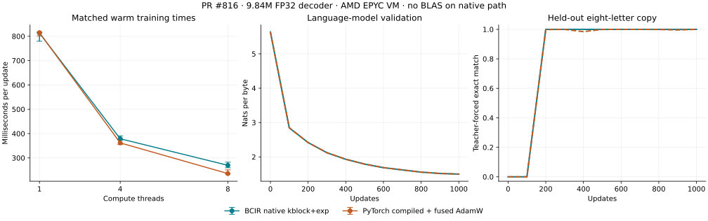

# PR #816 performance rerun: data structures and native decoder training

PR #816 cuts the selected native decoder's warm update from 1,191 ms on the
previous serial path to 270 ms with kblock+exp and eight threads: **4.42×**. Full
1,000-update training preserves quality against compiled PyTorch, with native
267 ms/update versus Torch 237 ms and lower native peak RSS. BPE encoding gains
27–78×, with 7.6–9.4× greater peak Python allocation. GEMplus/ASN.1 outputs and
sources remain unchanged across this PR.

This assessment reruns the training accelerator ladder on a host with both BCIR
and CPU PyTorch. It compares the immediate pre-PR revision with the merged PR,
then tests the new native arithmetic contracts and thread pool on identical
9.84M-parameter decoder inputs. The report and measurement scripts change no
production implementation or model semantics.

## Revisions, host and controls

| Item | Value |
| --- | --- |
| Before | `379ee9b611864dc1b58094f3f5098686541e053d`, immediately before #816 |
| After | `be6e377a2eb417cb4bfe3de5243ca09961ba1833`, merged #816 |
| Corpus | `75d50d4f6e280e35a25032024edffd92f25c52f2`, as in the 2026-10-11 experiment |
| Host | AMD EPYC 9V74 VM, 8 CPU cores of quota, 9 CPUs in affinity, 8 GiB memory |
| Native build | GCC 13.3, `-O3 -ffp-contract=off -fno-math-errno`, FP32 |
| Libraries | Python 3.12.14, PyTorch 2.14.1+cpu, NumPy 2.3.5, scipy-openblas32 0.3.34.237.0 |
| Execution | One benchmark process at a time; 1/4/8-thread matched timing conditions |

All wall timings are indicative VM measurements, not hardware certificates.
There is no GPU, native ARM, AMX, PMU, energy or bare-metal result. This AMD host
does advertise AVX512_BF16; the current ladder has no BF16 training implementation,
so all observations remain FP32. No benefit is attributed to UEFI boot or removal
of Linux, neither of which this experiment exercises.

The earlier report's Intel VM could not install PyTorch. Its absolute times must
not be compared with these AMD measurements. The October 10 decoder experiment
also used batch 4 × context 64; this experiment uses batch 8 × context 128, four
times as many tokens per update. PR #815 already supplied substantial native
kernel improvements; those are in **both** revisions here.

Raw call samples, hashes, process records and the import reproducer are retained
in the dated measurement directory. The unchanged October 10 harness is used for
the data structures. Each of its seven stages ran three times on each revision,
alternating revision order: **42 successful observations**. Summary timings are
the median of the three observation medians; fixture creation stays outside timers.

The original October 11 training harness unconditionally sets Torch to one
compute thread, even when given `--threads`. The new adapter changes those
measurement-only settings, verifies `torch.get_num_threads()`, and loads each
revision's own binding and C library. ABI 1 is never mixed with ABI 3. Three
32-update timing runs per configuration use fresh weights, the same schedule
prefix, quarter-rate AdamW and bounded evaluation. Updates include batching,
forward, backward, clipping and the optimizer; the first two updates are excluded
from warm medians. These short runs assess time, not trained-model capability.

## GEMplus, StreamPack and ASN.1

These source files are byte-identical before and after #816: StreamPack, delta
chain, async tokens, dependency-frontier construction, the planner, the native
hydrate and the ASN.1 C generator. The output checks agree. Their small timing
differences are descriptive host variation, not evidence of a new algorithm.

| 32,768 claims; milliseconds | Before | After |
| --- | ---: | ---: |
| Python planner | 290.889 | 273.475 |
| C planner | 19.731 | 18.810 |
| Python encode | 117.781 | 122.009 |
| Python decode | 181.197 | 183.437 |
| C plain hydrate + wire production | 21.342 | 20.709 |

All native hydration outputs equal Python's complete wire bytes. The largest
pack is 5,762,585 bytes with SHA-256
`310e1bf6a59a422265d1bc7e2c6cff0dba7d6f91886a3f86f9fe6ec8cc405cd8`
on both revisions. The accepted delta edits have byte parity with full rebuilds
and no diagnostics; no rejected resource-overrun edits are timed as useful work.
Native planning and hydration retain their advantages over Python object-heavy
paths, but #816 does not further reduce the costs of full-pack copying/checksumming.

ASN.1 fixed-width array decode at 32,768 elements:

| Representation | Bytes | Before µs | After µs |
| --- | ---: | ---: | ---: |
| Raw 16-bit | 65,536 | 17.487 | 17.249 |
| COER | 65,539 | 21.986 | 21.808 |
| UPER | 36,864 | 29.793 | 30.589 |
| Hand-packed 9-bit | 36,864 | 19.469 | 19.510 |

UPER saves 43.75% of bytes relative to raw16 but remains slower to decode in this
fixture. It does not establish that ASN.1 is faster than raw binary generally.
The generated codec source hashes, round trips and invalid-input rejections
match across revisions; the ITS envelope stage also passes unchanged. Select
packing where measured transport/storage savings exceed codec work, rather than
inserting it into hot tensor arithmetic without an end-to-end measurement.

The 8 MiB CRC row remains about 19.77 ms in BCIR C versus 2.28 ms in zlib.
At 8,192 claims the async all-hazard builder still produces 53,616 edges; the
frontier control produces 14,752 with the same transitive closure, about 13.28
versus 7.86 ms. These remain concrete opportunities from the previous assessment.

## BPE: a large encoding gain with a memory tradeoff

One tokenizer is trained once on a pinned 32 KiB document prefix, then loaded
unchanged into both revisions: vocabulary 1,024 with 764 merges. Seven calls per
payload alternate encoder order. Input normalization and output-list allocation
are timed; tokenizer training is excluded and unchanged. Peak allocations are
measured separately with `tracemalloc`, not confused with process RSS.

| UTF-8 bytes | Before ms | After ms | Speedup | Peak allocations before / after MiB |
| --- | ---: | ---: | ---: | ---: |
| 1,024 | 56.662 | 0.726 | 78.01× | 0.017 / 0.130 |
| 8,192 | 443.056 | 6.725 | 65.88× | 0.128 / 1.183 |
| 65,536 | 3,487.154 | 83.032 | 42.00× | 1.073 / 9.725 |
| 262,144 | 15,340.231 | 564.448 | 27.18× | 4.166 / 39.034 |

The heap and linked-index encoder delivers the intended preprocessing gain.
Outputs match for every payload and 200 additional Unicode/BOS/EOS cases using a
normally trained tokenizer. Peak Python allocation rises 7.6–9.4×: useful speed
has been purchased with heap/index storage. Large-document streaming needs a
memory budget and boundary-correct chunking; arbitrary chunks can change BPE
merges. A future C implementation should use compact indices and caller-owned
workspace, preserving the measured encoder's exact rank/tie semantics.

**Import compatibility finding:** the public constructor and JSON importer
accept `merges=((101,102,260),(101,102,261))`. For text `ab`, the old encoder emits
`[260]`; the new encoder emits `[261]`. `_ranks()` keeps the last duplicate pair,
whereas the former ordered passes apply the first one. Tokenizer training does
not generate this artifact, but the artifact's schema/digest did not change and
import accepts it. Preserve first occurrence semantics, or explicitly reject
duplicate pairs with a documented migration policy, and add an import regression.
The recorded witness is a correctness finding; production is unchanged here.

This decoder uses byte tokens, not the separately tested BPE tokenizer. BPE's
encoding speedup is **not** multiplied into the decoder's training throughput.

A further seven-sample alternating GC control on the new encoder found **no
benefit from pausing cyclic collection**: 64 KiB is 82.30 ms enabled / 83.39 ms
paused, and 256 KiB is 511.67 / 523.76 ms. All outputs match and post-call
collection finds zero cyclic garbage, but eliminating 45/183 generation-0
collections does not produce a speed gain in these samples. Keep the measured
production GC policy; compact data representation is the stronger next target.

## Decoder timing and quality

The fixed architecture is vocabulary 260, width 384, six layers, eight query
heads/four KV heads, FF width 1,024, SwiGLU, RoPE and tied embeddings:
**9,836,928 trainable parameters**, 1,024 tokens per update. Identical architecture
isolates the backend change; architecture redesign is not counted as a speedup.
The native side runs the complete C forward/backward and AdamW path, including
attention, norms, embeddings, rotary transforms, SiLU/SwiGLU and matrix VJPs.
`kblock+exp` uses BCIR's own intrinsic kernels and pool, with no BLAS provider.
Torch eager and compiled use the same HostedLlama weights; compiled includes
fullgraph forward/AOT backward and fused AdamW.

The initial weights and schedule exactly reproduce the published protocol:

- Weights SHA-256: `00e5b3593ee3159a2cb5b56b8827a74df5170f146d83b6bdad9421c77e477b82`.
- LM schedule SHA-256: `fe2ab3a16df2bfdd97792380f8078fe9924ec3bf5eae5590a174f87e8725e7bb`.
- 404 pinned documents, source-path-disjoint splits: 368 train, 20 validation,
  16 test. Exact/near-duplicate document leakage is not newly audited here.
- AdamW β1=.9, β2=.95, ε=1e-8, decay=.1, clipping=1; peak LR=.0005,
  floor=.00005, 50-update warmup and 1,000-update cosine for full runs.

The copy task follows the published replacement-label protocol: unpredictable
prompt positions are labeled token 258 (`IGN`), and the model learns that label.
Those positions still contribute to training cross-entropy; this is not a
zero-weight loss mask. Evaluation scores only the answer positions on 2,000
held-out problems. Teacher-forced exact match means every answer byte was right,
not an independent free-running generation benchmark. Both backends use exactly
this objective; a future true masked-loss experiment must be named separately.

### Three repeated 32-update timing runs

Ranges below are the minimum and maximum of three run medians, not confidence
intervals. Peak RSS is the median of the three separate-process peaks, including
the Python binding/experiment environment; it is not the C arena alone.

| Backend / contract | Compute threads | Median ms/update | Range ms | Tokens/s | Peak RSS MiB |
| --- | ---: | ---: | ---: | ---: | ---: |
| Before: BCIR native v1 | 1 | 1,191.40 | 1,179.92–1,246.42 | 860 | 534.6 |
| After: BCIR native v1 | 1 | 1,173.83 | 1,140.96–1,178.35 | 872 | 534.7 |
| After: BCIR native kblock+exp | 1 | 813.12 | 779.53–814.93 | 1,259 | 534.7 |
| After: BCIR native v1 | 4 | 560.53 | 557.90–592.36 | 1,827 | 534.7 |
| After: BCIR native kblock+exp | 4 | **378.66** | 373.13–390.54 | **2,704** | 534.7 |
| PyTorch eager | 1 | 823.01 | 817.54–826.75 | 1,244 | 735.0 |
| PyTorch compiled + fused AdamW | 1 | 814.67 | 800.95–817.39 | 1,257 | 706.0 |
| PyTorch eager | 4 | 372.22 | 360.74–390.70 | 2,751 | 732.6 |
| PyTorch compiled + fused AdamW | 4 | **361.67** | 355.11–378.31 | **2,831** | 705.8 |

The selected native path is **3.15× faster** than pre-PR native v1. The pool alone
gives 2.09× against current one-thread v1, and `kblock+exp` gives another 1.48×
at four threads. This is an opt-in compound gain: existing default v1 timing
barely changes. One-thread native kblock+exp is essentially level with Torch;
four-thread native is 1.7% slower than eager and 4.7% slower than compiled by
these medians. Ranges overlap, so this is close parity on this host, not a robust
speed victory. Native peak process RSS is roughly 24% below compiled Torch here.

All nine v1 native runs (before/after and 1/4 threads) end in exactly one
weights-and-two-moments digest, `30b1d0ed…`. All six accelerated native runs end in
one distinct digest, `a5671858…`. The new arithmetic does change numerical
semantics, explicitly; parallelism under one contract does not change the state.
Torch eager repeats and one-thread compiled repeats each reproduce their own
digest; four-thread compiled produces three final digests. Final short-run CE
and gradients are retained separately, not asserted bit-identical to native.
The largest four-thread compiled repeat difference is 4.77e-7 in training loss
and 8.43e-9 in final validation CE; differing digests here are not a measured
learning-quality failure.
Full trained-model quality is assessed below rather than inferred from timing.

The first-two-update field includes compilation/cache loading and warmup; the
smoke runs already populated a Torch compiler cache. It is not an independently
measured cold compile latency. Native GCC compilation is outside the warm
training timer. Neither backend's step median is a deployment startup estimate.

### Eight-thread tuning screen

Three further 32-update runs per backend use the host's full eight-core quota.
This is a compute-thread experiment, not concurrent build/test workers.

| Backend | Threads | Median ms/update | Range ms | Tokens/s | Peak RSS MiB |
| --- | ---: | ---: | ---: | ---: | ---: |
| BCIR native kblock+exp | 8 | **269.50** | 259.69–282.50 | **3,800** | 534.8 |
| PyTorch eager | 8 | 263.84 | 257.93–267.78 | 3,881 | 736.6 |
| PyTorch compiled + fused AdamW | 8 | **235.60** | 233.39–250.81 | **4,346** | 713.0 |

Both backends are faster at eight than four, so the full quality runs use eight
threads on both sides. BCIR's best tested setting is 4.42× faster than the old
serial native path. It is 2.1% slower than eager and 14.4% slower than compiled
Torch in this screen. The accelerated native state is still exactly `a5671858…`.
The four-to-eight-thread speedup is 1.41× native and 1.54× compiled Torch; the
remaining serial work/barriers and memory traffic are candidates to measure,
not grounds to predict another ideal doubling. A host-aware scheduling cost
vector should include thread-count scaling, not just operation count and ISA.

### Full 1,000-update language-model runs

Each side trains on 1,024,000 scheduled tokens from the same byte corpus. Full
evaluation uses 8,192 validation tokens and 16,384 test tokens, not the short
timing screen's 1,024-token subsets. One seed is tested; numerical parity here
does not establish multi-seed convergence or general LLM capability.

| Eight-thread backend | Median ms/update | Training seconds | Validation CE | Test CE | Test byte accuracy | Test word exact match | Peak RSS MiB |
| --- | ---: | ---: | ---: | ---: | ---: | ---: | ---: |
| BCIR native kblock+exp | **266.93** | 272.28 | 1.500108 | **1.631885** | 53.754% | 7.180% | **534.8** |
| PyTorch compiled + fused AdamW | **237.05** | 239.07 | 1.499766 | **1.631859** | 53.711% | 7.180% | 742.5 |

Validation CE differs by 0.000342 nats and test CE by **0.000026 nats**, both
within the roadmap's 0.001-nat criterion. Test word-completion exact match and
answer accuracy are identical. The native trained state is
`d7fc618c9eeb8b6f74fe6c0b83df8485370939eb46caf144253912a7e2e8b0a0`,
exactly the published Intel-host 1/4-thread state, now reproduced on AMD at eight
threads. This is stronger reproducibility evidence than approximate accuracy
alone. The saved native checkpoint contains weights, both AdamW moments and the
step/bias-power metadata; the Torch checkpoint retains model and optimizer state.

BCIR remains 12.6% slower per warm update than compiled Torch in this full run,
with about **28% lower peak process RSS**. Wall time including model setup and
evaluations is 285.86 versus 250.67 seconds; this excludes the adapter's native
library build/process startup and checkpoint serialization. The broad gain is
real and learning quality holds, but the selected decoder does not yet beat
compiled PyTorch end to end on this host.

### Full 1,000-update copy-task runs

| Eight-thread backend | Median ms/update | Training seconds | Final answer CE | Answer accuracy | Exact match, 2,000 problems | Peak RSS MiB |
| --- | ---: | ---: | ---: | ---: | ---: | ---: |
| BCIR native kblock+exp | 267.80 | 276.68 | **0.000559** | **100%** | **100%** | **595.5** |
| PyTorch compiled + fused AdamW | 241.55 | 244.97 | 0.000622 | **100%** | **100%** | 924.0 |

Final CE differs by 0.000063 nats, within 0.001, with identical perfect answer
accuracy/exact match. Native is 10.9% slower per update, with about 36% lower
peak RSS in this task. First sampled 100% exact match occurs at update 200 on
native (55.34 training seconds) and 600 on Torch (148.08 seconds). This is a
one-seed learning-trajectory observation, not a general faster-convergence claim:
the curves fluctuate afterward, and the headline result uses the fixed final
checkpoint on each side. The same held-out set is monitored every 100 updates;
there is no early stopping or hyperparameter adjustment during these runs.



### Native identity and phase breakdown

The separate eight-update identity sweep has **24 rows**: v1 and kblock+exp,
1/2/4/8 threads, widest AVX-512 and restricted AVX2 builds, plus a widest repeat.
There is exactly one state digest per contract, and the contracts are distinct.
This complements the repeated 32-update checks and the 1,000-update Intel/AMD
state match. It does not substitute for ARM or GPU execution.

Five-round warm phase medians through the actual native pool/contract entry
points, in milliseconds:

| Family | v1, 1 thread | kblock+exp, 1 | kblock+exp, 4 | kblock+exp, 8 |
| --- | ---: | ---: | ---: | ---: |
| Matrix forward | 321.10 | 201.12 | 88.20 | 56.86 |
| Matrix backward | 629.63 | 399.65 | 190.93 | 112.57 |
| Attention forward + backward | 81.93 | 75.03 | 31.47 | 23.28 |
| SiLU + SwiGLU backward | 105.43 | 12.57 | 5.77 | 3.95 |
| AdamW/update, including validation and clipping | 54.30 | 49.76 | 39.47 | 38.21 |
| Full step, including batch/binding | **1,247.47** | **770.11** | **398.75** | **267.91** |

These are staged family measurements, not an instrumented exclusive call trace;
the independent medians and residual must not be interpreted as exact accounting.
At eight threads they nevertheless locate the main work: matrices about 63% of
the step, update about 14%, attention about 9%, with other kernels/residual making
up the remainder. SiLU/SwiGLU gain about 8.4× from the new exponential at one
thread; matrix work gains about 1.58× at one thread under the selected blocked
contract. The update's 39.47 → 38.21 ms from four to eight threads is nearly flat.

Prioritize measured GEMM packing/scheduling and the update's serial passes.
Parallelize associative validation/maxima separately from the index-order norm,
or introduce a declared fixed-shape reduction contract with its own quality and
identity gates. RMSNorm backward also remains near 5.8–6.0 ms across these pool
settings. At longer context, attention's quadratic probability storage still
requires tiled/recomputed forward/backward; its 9% share at T=128 is not a
long-context prediction.

### Provider admission is host-specific

OpenBLAS under `kblock+exp` is refused on this AMD host: **14 of 30 admission
GEMM cases differ** from `bcir_tensor_mm_kblock`. No training result is produced
for that backend, and admission is not bypassed. The Intel-host result admitted
OpenBLAS's SkylakeX arithmetic; it does not promise admission on other target
kernels. This is the guard working, not proof that OpenBLAS cannot train a model.
An alternative provider policy must name its own arithmetic/tolerance contract
and validate full training quality; it cannot silently claim bit identity.
The wheel here advertises the same `0.3.34.237.0 ... SkylakeX` configuration as
the admitted Intel run. One-thread admission also has 14 mismatches. The cause
is not isolated; version/configuration labels alone do not establish numerical
identity. This run additionally records the actual provider library SHA-256.
Add provider-enabled CI on supported Intel and AMD targets: the current workflow
does not explicitly install `scipy-openblas32`, and its optional-wheel identity
tests cannot substantiate universal provider admission when the wheel is absent.

### What the legacy kernel stages measure

The unchanged October 10 kernel JSON labels one column `portable_c`, but its
entry point now ISA-dispatches native **v1**. It is not a no-dispatch portable
build and does not select `kblock+exp`. Those default matrix and attention rows
remain close before/after #816. Attribution of the accelerated training result
therefore comes from the explicit contract/pool runs and the pooled breakdown,
not from relabeling those old rows. `NativeDecoder` still defaults to `v1` and one
thread: selecting the faster contract is an explicit numerical-policy choice.

## Recommended next updates

| Priority | Update | Evidence and acceptance criterion |
| --- | --- | --- |
| P0 | Fix duplicate-pair BPE import semantics | The accepted-artifact witness changes token IDs. Add constructor/JSON parity, preserving or explicitly migrating prior artifacts. |
| P0 | Correct optional-provider portability assertions | Two existing tests assume every importable OpenBLAS wheel has zero mismatches. Test acceptance when the differential matches and clean refusal/fallback when it does not; retain the mismatch evidence. |
| P1 | Publish a usable training backend/contract/thread policy | Existing default callers do not select the accelerator ladder. Record selected ISA, thread count, arithmetic contract and provider admission in every card; benchmark choices on the actual host. |
| P1 | Make GEM+ plans drive the native step | The scheduler/plan execution slice remains open. Instrument per-call choices and prove the executed trace equals the admitted plan before claiming planner gains in training. |
| P1 | Tile attention and recompute probabilities in backward | The current probabilities are O(B·H·T²); the small-context ladder does not remove the long-context bottleneck. Test forward and VJP errors plus time/arena curves at 64–1,024 context. |
| P1 | Profile remaining GEMM packing and small-depth shapes | Continue native-kernel specialization under declared contracts; use measured shape/layout buckets and compare against providers on each CPU. No blanket admission based on an Intel result. |
| P1 | Preserve throughput while bounding BPE workspace | Heap/index allocations rise up to 9.4×. Compact C indices/caller workspace should retain all token IDs and normalization/tie cases; report training and encoding independently. |
| P1 | Pool associative update validation and measure serial reductions | Update is about 14% of the eight-thread step and nearly flat from four threads. Keep fixed-order gradient sums or declare a fixed-shape tree contract; validate learning across seeds. |
| P2 | Lifetime-plan the transient training arena | Measure scratch liveness and alias safety; retain capacity refusal, checkpoint/resume, and output equivalence. Byte packing alone does not reduce float activations. |
| P2 | Add explicit token/sample loss masks and weights | The structured-task harness replaces labels rather than zeroing their losses. Add defined reductions/empty-mask behavior with C/reference gradients; benchmark the new objective separately from this pinned protocol. |
| P2 | Reuse the dependency frontier in async-token construction | 53,616 → 14,752 edges in the control with equal closure; verify event/transfer order on adversarial DAG shapes. |
| P2 | Reduce full-pack CRC/copy work | 8 MiB CRC still trails zlib by about 8.7×; delta updates still materialize whole packs. Preserve the specified CRC polynomial and wire bytes; SSE4.2 CRC32C is not a drop-in IEEE CRC substitute. |
| Hardware | BF16, accelerator kernels and distributed training | The host's BF16 instruction flag is not an implemented path. Add explicit master-weight/accumulation contracts and multi-seed quality tests, then native ARM/GPU/communication/checkpoint measurements on real hardware. |

Keep the execution core in C; C++ belongs at optional framework/accelerator
integration boundaries. The current results do not require a C++ rewrite of
training. A capability claim beyond this decoder needs operator coverage,
multiple model sizes/context lengths, seeds, realistic data and hardware, and
end-to-end integration measurements.

## Reproduction and validation

The dated adapter and matrix driver reuse the checked-in October 11 preparation
and training code. Dependencies are experiment-only. Each native build uses the
selected tree's C sources and ABI binding. Large corpus arrays and checkpoints
are not committed as Git fixtures; the preparation stage regenerates inputs from
the pinned commit and validates their hashes.

See [results.json](measurements/2026-10-13/results.json),
[verification.json](measurements/2026-10-13/verification.json), and the
[training adapter](measurements/2026-10-13/rerun_training.py). The raw result
includes all 42 structure observations, 36 successful timing observations,
three provider refusals, four 1,000-update runs, 24 identity rows, four breakdowns
and both BPE experiments. Wall times are never CI thresholds.

From the merged tree, with the experiment environment's Python on PATH:

```bash
python -m pip install torch==2.14.1+cpu --index-url https://download.pytorch.org/whl/cpu
python -m pip install numpy==2.3.5 scipy==1.17.0 scipy-openblas32==0.3.34.237.0 matplotlib==3.10.8 pytest==9.1.1 ruff==0.16.6
git worktree add --detach ../BCIR-pre816 379ee9b611864dc1b58094f3f5098686541e053d
python docs/research/measurements/2026-10-11/train_comparison.py prepare --output ../pr816-rerun/data --lm-steps 1000 --copy-steps 1000 --recall-steps 32 --add-steps 32
python docs/research/measurements/2026-10-13/run_structures.py --before ../BCIR-pre816 --after . --output ../pr816-rerun
python docs/research/measurements/2026-10-13/benchmark_bpe.py --before ../BCIR-pre816 --after . --output ../pr816-rerun/bpe
python docs/research/measurements/2026-10-13/run_matrix.py --before ../BCIR-pre816 --after . --data ../pr816-rerun/data --output ../pr816-rerun/timing
python docs/research/measurements/2026-10-13/run_matrix.py --before ../BCIR-pre816 --after . --data ../pr816-rerun/data --output ../pr816-rerun/eight-thread-screen --eight-thread-screen
python docs/research/measurements/2026-10-13/run_quality.py --repo . --data ../pr816-rerun/data --output ../pr816-rerun --threads 8
python docs/research/measurements/2026-10-13/benchmark_bpe_gc.py --repo . --bpe ../pr816-rerun/bpe --output ../pr816-rerun/bpe/gc-control.json
python docs/research/measurements/2026-10-13/verify_results.py --output ../pr816-rerun/verification
python docs/research/measurements/2026-10-13/record_metadata.py --repo . --root ../pr816-rerun --controls
python docs/research/measurements/2026-10-13/collect_results.py --root ../pr816-rerun --output ../pr816-rerun/results.json
python docs/research/measurements/2026-10-13/plot_results.py --results ../pr816-rerun/results.json --output ../pr816-rerun/training-comparison.svg
```

`record_metadata.py` regenerates source hashes, the host/library configuration
and binary hash, and standalone exp/checkpoint controls rather than substituting
this host's metadata. The collector writes one combined JSON;
`plot_results.py` renders the figure from that JSON. Run all heavy stages
serially, with at most two build/test
workers; compute thread counts belong to the specified benchmark conditions.

Local verification on GCC 13.3 / Python 3.12.14:

- Complete quick oracle, `--tier quick -j 2`: **4,562 passed, 0 failed**.
  Repeated with all report artifacts tracked: the same 4,562-pass result.
- Focused native decoder, hosted training pipeline and C training kernels:
  **26 passed, 2 failed**. Both failures are the merged tree's optional OpenBLAS
  assertions (`test_the_compiled_plan_and_gemm_are_the_programs` and
  `test_a_provider_is_admitted_under_the_blocked_contract_only_where_it_is_the_contract`),
  each assuming the wheel's differential must be zero; actual mismatch count is
  14. They are reported as a portability-test gap, not hidden as a pass.
- Standalone native exp sweep: **8,749,570 sampled inputs**, zero instance
  mismatches, maximum one ULP against the double-exp/binary32 reference. This
  explicitly covers the check after the failing optional-provider assertion.
- Both saved native 1,000-update checkpoints resume on one thread with the same
  weight/moment digests and step 1,000; complete counter/bias-power digests are
  retained in `native_controls`.
- Docs status, relative links, retired paths, summary claims, law ranges, import
  quarantine, oracle inventory, all-tree pinned Ruff formatting/lint and diff
  checks pass. Production trees are unchanged.
  CI initially treated four public encoded-ID digest fields as credential
  assignments. The fields are now `encoded_ids_sha256`; all hash values and
  timings are preserved, with zero tracked-file scan findings and no scanner
  policy change.
- Latest-toolchain status/check were attempted: LLVM/Clang/MLIR 23.1.3 are
  missing, Node 24.19.0 is behind 24.21.0, and Python 3.15.0 release is missing.
  The local `uv` catalog installs 3.15.0rc3 and cannot supply 3.15.0; that
  prerelease is not counted as a release-toolchain pass. Latest-toolchain,
  Windows, full model/C/MLIR and native ARM checks are delegated to the full
  GitHub Actions matrix. No unavailable hardware is emulated.

The existing #816 head's full Actions run
[`38302062046`](https://github.com/Mecca-Research/Binary-Correspondence-Intermediate-Representation/actions/runs/38302062046)
passed. The report PR's own Actions result is recorded in its description after
the complete matrix finishes; it does not retroactively validate this host's
refused optional provider.
