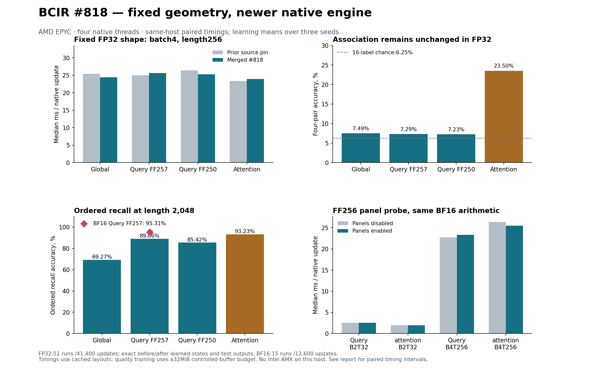

# BCIR PR #818: merged runtime rerun of the full global/query head

Completed 2026-10-18T22:53:36.824980+00:00 · native C, controlled CPU research

## Result

The merged update has been rebuilt and the geometric-head experiments have been rerun. **All 51 FP32 runs / 41,400 updates reproduce the previous selected and final training states exactly.** All 600 fixed model/context evaluation groups and 120 counterfactual test groups were executed again and reproduce the prior predictions and metrics exactly. Each group contains multiple scored examples or tokens; these counts are not independent training replications. These are regression samples reused from the previous study, not a new unseen holdout.

The query-aware contraction retains its ordered-recall benefit and its association-learning limitation at this budget. This update supplies execution mechanisms and leaves the retained head's equations unchanged. The result does not prove that a multilayer prefix model can never learn bindings; it leaves the representation/training question open. Timing changes must be read against the exact previous source pin, which already included much of PR818.

An additional **15 from-scratch BF16 runs / 12,600 updates**, matched to the same three seeds and initial states, test the new numerical family. Their results are separated below. The host is AMD EPYC 9V74, with AVX-512F and BF16 CPU features but **no Intel AMX**. This is not a rerun of the upstream Intel-AMX versus compiled-PyTorch throughput comparison.

**The notable new learning result is BF16 ordered recall at length2048: 89.06%→95.31%** for the queryFF257 head, across three matched seeds on64 fixed examples/model. Association remains near chance and language loss is effectively unchanged. The isolated AdamW updater is 1.334× faster; full-head FP32 timing changes are mostly unresolved. BF16 adds packing storage and runs slower for the query head on this CPU, so the recall improvement comes with an accuracy/cost trade-off.



## 1. What changed, and what the previous experiment already had

[PR818](https://github.com/Mecca-Research/Binary-Correspondence-Intermediate-Representation/pull/818) merged at `2026-10-18T22:10:03Z`. Source identities:

| Role | Commit |
| --- | --- |
| Previous experiment's native source | `aaa2e6c0ee0ee15b83fe4d0373b48bd893e80d6d` |
| PR base | `be6e377a2eb417cb4bfe3de5243ca09961ba1833` |
| PR head | `f3e7f0be5f467ac154da8d0e096921acbc177ba4` |
| Merged main tested here | `237651126684569e5b756dcc8d1c89ed2e86d0e3` |

The PR changes **662 files, adds 390,139 lines and deletes 466**. Benchmark/measurement records account for **615 files and 380,107 added lines (97.43% of additions)**. The runtime C/header changes are 5 files, +4,481/−287. This is a substantial documented optimization campaign; the line count is mostly retained evidence rather than 390,000 new lines in the execution engine.

The previous pin is inside PR818's history. From that exact pin to merged main, the diff is 342 files, +270,809/−197; runtime is +2,393/−106. Crediting all of PR818's advertised gain as an additional gain over our previous study would double-count earlier work.

| Change | Effect on this research |
| --- | --- |
| Parallel scans/reductions, grouped and paired GEMM, fixed-shape FP32 blocks, pool scheduling and earlier SIMD work | Much was already in the old pin; retained in the matched control. |
| AdamW shared-division update | Newly grafted production updater; its bit-preserving claim is checked over all 41,400 FP32 updates and in isolated timing. |
| ABI4 and explicit BF16 packing workspace | Host records upgraded from 240 to 256 bytes; packing storage and alignment are included in budget admission. |
| Portable, AVX-512F and Intel-AMX BF16 GEMM instances | Distinct arithmetic contract; this host admits mask 5 (portable C, AVX-512F). No AMX instance is available here. |
| BF16 SwiGLU panel producers/readers | FF256 probe activates all 3 panel paths and agrees bitwise with panels disabled. Original FF257/250 model recipes are not silently changed to fit these panels. |
| Fused attention arithmetic | Separate bit 32 numerical option; timed separately from the fixed FP32 learning rerun. |
| Framework huge-page state allocation | Optional 2 MiB-aligned common mapping tested separately, with actual `AnonHugePages` evidence rather than treating accepted advice as allocated pages. |
| Duplicate BPE merge fix | First-ranked duplicate is retained. Focused regression passes. Byte-level datasets here have no BPE step, so this cannot explain their learning results. |
| Grassmann/Plücker head | Still the saved standalone C research overlay; no production geometric-head implementation was found in the merged runtime. |
| ASN.1 / GEM+ / signed-plan optimizer | No implementation change relevant to those engines in this PR; this report does not relabel tensor-buffer measurements as new ASN.1 or GEM+ results. |

`change-analysis.json` retains file-by-file diff counts, and `pr818-metadata.json` retains the retrieved PR description. The separate upstream 9,836,928-parameter AMX study reports 2.282× compiled PyTorch BF16 on an Intel Xeon, with 5 paired seeds/1,000 steps. Its hardware, model, software versions and numerical contracts differ. That reported ratio is neither reproduced nor contradicted by the AMD geometric-head measurements here.

## 2. Implementation and validation

`build_upgrade.py` ports the production tensor unit, dispatch/group/panel helpers, validity checks, attention entry and updater into the saved research overlays. It retains the full 231-coordinate rank 22 wedge, query-aware contraction, causal prefix/VJP, precision guard, masked loss, compact arena layouts and rematerialization equations. Old controls compile the original overlays against their original ABI3 tensor/header source. New overlays use ABI4. Everything is built without fast-math or implicit contraction.

Execution uses the native C training rail through the standalone Python host controller. Lowering this custom head through BCIR's general IR/GEM+ planner remains an integration task. Minibatches use ordinary native token arrays; ASN.1 training-data plumbing is not exercised by these measurements. This defines what the rerun attributes to kernels and explicit buffer plans.

The custom ignored-target path is preserved; production dense-target admission cannot simply replace it. Compact FF layouts have deliberate cross aliases that are safe for their elementwise FP32 writers. Their BF16 panel path remains disabled until those tiled writers have a separate alias proof. The cached FF256 variant is directly qualified for panels. This is an integration constraint, not an assumption that every backend switch is interchangeable.

Passed FP32 checks include independent Torch full-model forward/backward, guarded/near-collinear geometry, contraction VJP, exact legacy/new logits and gradients, checkpoint replay, thread/layout/shape transitions, equal-supervision accumulation, exact-capacity red zones, focused UBSan, and 96→32→20→64 MiB buffer reconfiguration. Separately, all 18 BF16 cached-versus-rematerialized cases pass logits, VJP and updated-state parity. All 3 FF256 panel paths execute and agree with the non-panel implementation. These BF16 parity checks do not assert that rounding is a differentiable operator; they qualify the declared mixed-precision training algorithm. The upstream native-decoder gate also passes gradients, AdamW, accumulation, checkpoint resume and training-to-Q8-C inference.

This was a focused training/runtime study, not a new repository release qualification. GCC 13.3, Python 3.12.14, NumPy 2.3.5 and Torch 2.14.1+cpu were used. LLVM/MLIR 23, Python 3.15, native ARM64, Windows and AMX were unavailable; their full qualification gates were not run. `toolchain-status.log` retains the environment check.

## 3. Matched FP32 learning rerun

Seeds are 20261018, 20261019 and 20261020. The models use width 128, depth 3, vocabulary 260, tied embeddings, RMSNorm and SwiGLU. Global/query use rank 22 and no RoPE; attention uses 4 heads and RoPE. Parameters: Global 525,696; Query FF257 534,144; Query FF250 526,080; Attention 525,696. Hyperparameters, streams, initialization, validation checkpoint selection and update counts are unchanged. Recall trains 900 updates with batch 4 and balanced lengths 64/128/256; language trains 600 updates with 256 supervised bytes/update and balanced lengths 32/64/128. Arithmetic is contract 14; optimizer is native C AdamW.

Every training run has a common 32 MiB controlled-array/pool/staging/C-record envelope. Global/query retain batch 4; attention uses microbatch 2×accumulation 2 at T256. Both FP32 and BF16 choose the same microbatch/reconstruction tiers for these shapes. BF16 adds packing storage within the envelope. The bound excludes code, thread stacks, Python objects, datasets, checkpoints and allocator retention; **it is not RSS or process peak memory**. Fixed test inference has a separate common 512 MiB bound.

### Association

Each accuracy combines 256 examples at T128 and 256atT256, per selected seed. Values are three-seed means. Random guessing over 16 labels is 6.25%; guessing uniformly among the 4 known candidate values is 25%.

| Model | Old single-pair | New single-pair | Old four-pair | New four-pair |
| --- | --- | --- | --- | --- |
| Global | 5.34% | 5.34% | 7.49% | 7.49% |
| Query FF257 | 5.53% | 5.53% | 7.29% | 7.29% |
| Query FF250 | 5.53% | 5.53% | 7.23% | 7.23% |
| Attention | 100.00% | 100.00% | 23.50% | 23.50% |

The query heads remain near chance. The value-swap and query-change counterfactual outputs are also unchanged. Faster kernels do not establish a new association-learning capability.

### Ordered recall and language

| Model | Old T1024 | New T1024 | Old T2048 | New T2048 |
| --- | --- | --- | --- | --- |
| Global | 95.31% | 95.31% | 69.27% | 69.27% |
| Query FF257 | 99.48% | 99.48% | 89.06% | 89.06% |
| Query FF250 | 100.00% | 100.00% | 85.42% | 85.42% |
| Attention | 100.00% | 100.00% | 93.23% | 93.23% |

| Model | Old byte-language CE | New byte-language CE |
| --- | --- | --- |
| Global | 2.458640 | 2.458640 |
| Query FF257 | 2.456714 | 2.456714 |
| Query FF250 | 2.456313 | 2.456313 |
| Attention | 2.172802 | 2.172802 |
| Hybrid | 2.222057 | 2.222057 |

Language CE is weighted over test lengths 32/64/128, lower is better. The query head's long ordered-recall advantage remains intact, while native attention and the separate language-focused hybrid retain lower language loss. This update does not change that ranking under the fixed FP32 training recipe.

`results/before-after-audit.json` compares every selected and final state digest, input digest, validation record and per-update loss/gradient norm against the prior study; it also compares the rerun predictions, labels, CE and counterfactual outputs exactly. Whole NPZ file hashes are not used as substitutes for model-state equality.

## 4. Same-host paired performance

Historical session wall times are retained but are not used to attribute speed gains. The following tests alternateAB/BA for 24 paired rounds,3 updates/observation, fixed synthetic dense targets, warm pools and an identical state restored outside each timed call. All use the same 4 logical CPUs and 4 native threads; no other experiment runs concurrently. Ratios above 1 favor the new/right-hand configuration. Intervals bootstrap repeated paired timing observations on this one host; they do not describe hardware-population uncertainty.

Old/new rows use the same cached compact layout and allocation method with an ample arena, rather than the 32 MiB rematerialization policy. They isolate engine cost at fixed shape. They are full native updates, not scalar math microbenchmarks. AdamW-only includes its norm/clipping and API validation but excludes backward. The ratio is the median of paired ratios; it need not equal the quotient of the two separately reported timing medians.

| Test | Old ms/update | New ms/update | Old/new | Paired 95% interval |
| --- | --- | --- | --- | --- |
| AdamW-only/534144 parameters | 0.638 | 0.472 | 1.334× | 1.315–1.395 |
| global/B4T128 | 13.827 | 12.791 | 1.000× | 0.898–1.065 |
| query_full/B4T128 | 13.991 | 13.628 | 1.018× | 0.975–1.054 |
| query_matched/B4T128 | 13.297 | 13.174 | 1.003× | 0.971–1.060 |
| attention/B4T128 | 13.180 | 12.867 | 1.024× | 0.974–1.072 |
| global/B4T256 | 25.442 | 24.443 | 1.049× | 1.017–1.082 |
| query_full/B4T256 | 25.016 | 25.608 | 1.023× | 0.966–1.060 |
| query_matched/B4T256 | 26.398 | 25.303 | 1.025× | 0.991–1.069 |
| attention/B4T256 | 23.333 | 23.911 | 1.004× | 0.949–1.046 |
| global/B4T512 | 47.665 | 48.799 | 1.001× | 0.971–1.059 |
| query_full/B4T512 | 47.318 | 48.574 | 0.970× | 0.956–1.021 |
| query_matched/B4T512 | 47.341 | 45.157 | 1.074× | 0.970–1.112 |
| attention/B4T512 | 55.632 | 55.908 | 0.998× | 0.929–1.049 |

The isolated optimizer is 1.334× faster (paired interval 1.315–1.395). Eleven of the twelve full-model FP32 intervals include 1; the global T256 cell is 1.049× (1.017–1.082). These are individual descriptive intervals without a multiple-comparison correction. They support a faster optimizer and mostly unresolved small whole-head changes on this host. The isolated optimizer multiplier must not be presented as the same multiplier for the entire head.

### Panel buffers

Same merged runtime and BF16 contract 26, FF256 only; A disables panels and B enables them. Exact updated states agree on every paired trial. All 3 panel paths are exercised. Observed workspace high-water marks are retained beside admitted upper bounds; they are not a proof of a globally minimum allocation.

| Test | No panels ms | Panels ms | A/B | Paired 95% interval | Observed / admitted packing bytes |
| --- | --- | --- | --- | --- | --- |
| query_full/B2T32/FF256 | 2.537 | 2.522 | 1.002× | 0.940–1.083 | 213,056 / 295,168 |
| attention/B2T32/FF256 | 1.968 | 1.948 | 0.984× | 0.940–1.065 | 213,056 / 295,168 |
| query_full/B4T256/FF256 | 22.718 | 23.338 | 0.991× | 0.911–1.077 | 1,515,584 / 2,752,768 |
| attention/B4T256/FF256 | 26.348 | 25.483 | 1.037× | 0.999–1.088 | 1,933,376 / 2,752,768 |

### Huge-page placement

Same merged FP32 model on both sides; A uses the original separate aligned allocations, B the common 2 MiB-aligned `MADV_HUGEPAGE` arena. Each row restores the same state and agrees bitwise. Accepted advice and observed huge pages are distinct fields in the raw records. The page counts cover overlapping VMAs, including mapping padding. Default NumPy/Linux allocations may already receive huge pages; this is an allocation-strategy comparison, not a controlled small-page-versus-huge-page ablation. Mapping/page-table behavior is host-specific.

| Test | Default ms | Advised arena ms | A/B | Paired 95% interval | B observed huge pages, KiB |
| --- | --- | --- | --- | --- | --- |
| query_full/B4T128 | 13.935 | 14.499 | 1.007× | 0.950–1.043 | 20,480 |
| query_full/B4T256 | 26.966 | 27.804 | 0.978× | 0.956–1.007 | 36,864 |
| query_full/B4T512 | 49.102 | 49.637 | 0.959× | 0.935–0.988 | 63,488 |

No automatic placement win is established. AtT512, the advised common arena is slower in this sample despite real huge-page coverage. Retain a measured choice rather than assuming that page advice accelerates this head.

### New arithmetic options

Attention-FMA uses contract 46 against 14. BF16 uses 26 against 14. These intentionally change arithmetic; their bitwise state identity is not required. Initial dense-sample logit differences quantify numerical change but do not certify converged quality. Attention-FMA here is a performance probe; the full 51 run learning rerun keeps it off.

| Option / test | FP32 ms | Option ms | A/B | Paired 95% interval | Initial max logit difference |
| --- | --- | --- | --- | --- | --- |
| attention-FMA/B4T128 | 11.001 | 11.065 | 0.991× | 0.956–1.006 | 1.01e-06 |
| attention-FMA/B4T256 | 26.484 | 25.806 | 1.077× | 1.020–1.110 | 1.06e-06 |
| attention-FMA/B4T512 | 61.068 | 55.838 | 1.079× | 1.040–1.101 | 1.28e-06 |
| BF16/query_full/B4T256 | 28.480 | 30.952 | 0.877× | 0.852–0.917 | 0.00643 |
| BF16/attention/B4T256 | 25.233 | 27.409 | 0.960× | 0.916–1.020 | 0.0139 |

Attention-FMA shows about 1.077× at T256 and 1.079× at T512, with its intervals above 1; theT128 probe is unresolved. BF16 queryFF257 is slower on this AVX-512F fallback (paired speed ratio 0.877). The fallback in `bcir_tensor.c` expands BF16 operands and uses FP32 vector FMAs with separate even/odd accumulators to reproduce the declared AMX arithmetic. A CPU's AVX-512-BF16 feature flag therefore does not imply that this runtime is using a native BF16 dot-product path. Such a new instance would need its own parity or numerical-contract admission. These results favor testing the attention option further and keeping a hardware-specific arithmetic choice.

## 5. BF16 learning follow-up

The 15 case protocol was frozen before its first update:3 seeds each for four-pair Global/QueryFF257/Attention, ordered QueryFF257 and language QueryFF257. Architecture, data, initialization, rates, validation and selection stay fixed; only GEMM arithmetic changes to 26 and packing memory is counted. Attention-FMA remains off. QueryFF257 is preserved rather than silently replaced byFF256 to gain panel eligibility.

| Model/task | Metric | FP32 | BF16 | BF16 controlled buffers, MiB |
| --- | --- | --- | --- | --- |
| Attention / kv_curriculum | 4-pair accuracy, T128/256 | 23.50% | 23.44% | 30.671 |
| Global / kv_curriculum | 4-pair accuracy, T128/256 | 7.49% | 7.62% | 28.976 |
| Query FF257 / kv_curriculum | 4-pair accuracy, T128/256 | 7.29% | 7.29% | 29.363 |
| Query FF257 / lm | CE, lengths 32/64/128 | 2.456714 | 2.456726 | 15.743 |
| Query FF257 / ordered | T2048 accuracy | 89.06% | 95.31% | 29.363 |

The BF16 matching audit checks all 15 runs for identical model shapes except contract, input hashes, update/token counts, microbatch/reconstruction choices and fixed evaluation inputs. The T2048 ordered result is an observed **+6.25 percentage points** over the corresponding FP32 query head:

| Seed | FP32 T2048 | BF16 T2048 | Paired change |
| --- | --- | --- | --- |
| 20261018 | 87.50% | 98.44% | +10.938 points |
| 20261019 | 89.06% | 96.88% | +7.812 points |
| 20261020 | 90.62% | 90.62% | +0.000 points |

All six ordered checkpoints select step900. Each model is evaluated on the same 64 fixed examples; three trained seeds do not create192unique test examples. Two seeds improve and one is unchanged. This is a promising long-recall result at one scale and budget. More seeds and a fresh test set are needed to assess how reliably it transfers. BF16 changes the training trajectory; these results alone do not identify why long-context accuracy increased.

BF16 seed-level outcomes and counterfactuals are retained in `bf16/results`; a mean near chance should not be read as a meaningful association breakthrough. Its runtime on this AMD fallback is not an estimate of the Intel-AMX path. BF16 packing raises global/query recall storage by about 2.891 MiB and attention by about 1.375 MiB here, while stored parameters, gradients and Adam moments remain FP32. Therefore the production PR's half-RSS comparison to PyTorch is not a claim that our controlled head arena halves simply by enabling BF16.

## 6. What to update next

1. **Separate representation work from kernel work.** Retain the full query head as an ordered-recall candidate. Test an explicit key/value relationship write before aggregation: for example, a matched-capacity key⊗value or per-record geometric memory with a query read. A readout cannot reconstruct information that its write path discarded; whether the existing multilayer model can instead learn a sufficient write is still open. Keep single-pair, four-pair, multiset-preserving swaps and query-only changes as gates.
2. **Qualify an aligned FF256 geometry candidate.** Compare it against its own FP32 and non-panel BF16 controls, with equal data and an explicit parameter-count difference. Rank22 creates 231packed coordinates; panel padding and rank alignment are separate costs worth measuring rather than silently changing the model.
3. **Couple packing lifetimes with partial-layer caching.** The decoder admits a conservative sum of whole-call packs; record actual shared-operand group lifetimes and derive a safe smaller bound. The 100 native plan/packing queries in `results/buffer-inventory.json` expose a specific opportunity: atB4/T256, replacing one queryFF257 frame/FF-recomputed layer by a cached layer adds 3,051,520 activation bytes, with unchanged total scratch. The FP32 plan has 5,796,744 bytes of 32 MiB slack, enough arithmetically for one layer; the present portfolio chooses the same tier for all layers. BF16 has 2,765,448 bytes of slack, a 286,072-byte shortfall for that one-layer substitution. A tighter safe packing bound could make that mixed plan feasible. These are inventory-derived estimates, not implemented or timed mixed plans. Derive all mixed scratch/packing lifetimes before admitting one. Make BF16 panel element widths explicit before reclaiming storage in float-sized reservations; observed high-water marks alone are not universal bounds.
4. **Prove panel compatibility for rematerialized layouts.** The cross-alias FF scratch contract needs tiled-writer lifetime/overlap checks and parity/red-zone gates before panel writes can be enabled. Then remeasure whether panels plus rematerialization beat the current full-batch plan at the same 32 MiB limit.
5. **Promote arithmetic options only after quality gates.** Keep contract 14 as the regression reference; gate 26 and 46 separately with same-seed learning, nearly-collinear/absent-plane safeguards and target-hardware timing. Add Intel-AMX and native ARM64 runs when hardware is available. SIMD eligibility is not a universal throughput guarantee.
6. **Integrate the head through a maintained extension boundary.** This session's source grafts make the experiment concrete, but production adoption should expose its C geometry/VJP and arena requirements through stable IR/runtime interfaces, with source/contract/plan digests. That allows future tensor/updater work to flow into the head without repeated textual surgery.

This evidence supports continued optimization of a working C training engine and a memory-conscious ordered-recall architecture. It does not establish a theoretical maximum, universal dominance over PyTorch/JAX, or solved associative memory. Those require their own matched quality, hardware and workload comparisons.

## Reproduction and retained evidence

The companion ZIP retains both pinned native source sets and licenses, original geometric sources, ABI/generator/controller code, data, frozen protocols, build commands, validation results, paired observations, baseline records, all 66 selected checkpoints, quality outputs and this report. `MANIFEST_SHA256.json` records per-file hashes; the archive hash is delivered separately. Run these commands from the extracted `wedge-pr818` directory:

```sh
python -m venv --system-site-packages .venv
.venv/bin/pip install numpy==2.3.5 pyarrow==26.0.0 safetensors==0.8.0 matplotlib==3.10.8
.venv/bin/pip install torch==2.14.1+cpu --index-url https://download.pytorch.org/whl/cpu
.venv/bin/python build_upgrade.py
.venv/bin/python validate_update.py
.venv/bin/python study.py
.venv/bin/python benchmark_update.py
.venv/bin/python buffer_inventory.py
.venv/bin/python validate_bf16.py
.venv/bin/python study_bf16.py
.venv/bin/python evaluate_query.py
.venv/bin/python evaluate_bf16.py
.venv/bin/python summarize_query.py
.venv/bin/python audit_update.py
.venv/bin/python report_update.py
```

Run heavy commands sequentially. Existing study outputs are retained by the scripts; use a fresh copy without results/checkpoints for a from-scratch replication. GCC and pthreads are required. Rebuilding on another compiler/host may change binaries or numerical instances; preserve the stored evidence and label the new environment separately. Upstream repository gates additionally require a checkout of the recorded merge; the whole repository is not bundled.
